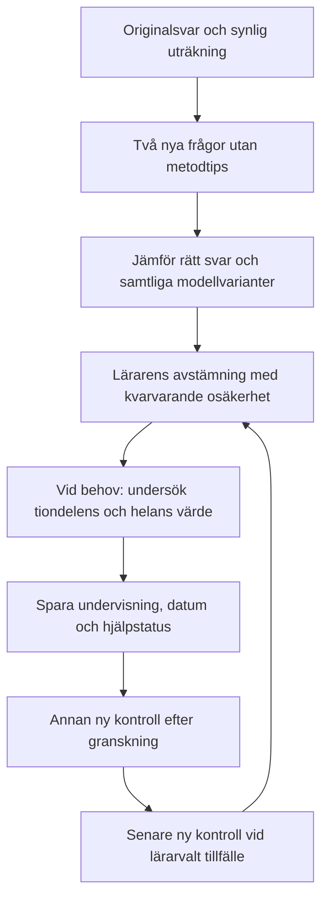

# E4: decimaladdition med två minnessiffror — godkänt paket

Status 2026-11-05: **innehåll, avgränsning och undervisningsgång godkända av Simon
genom ”Ja”. Paket och avgränsad regelutökning är lokalt byggda och verifierade; verifiering
redovisas nedan. Inte publicerat.** Befintlig rapport-/materialkedja används;
elevträning, mastery och åtkomstpolicy är oförändrade.

## Luckan och rekommendationen

V8 kunde beräkna `carry_forget` för decimaladdition, men saknade en granskad
decimalbankväg. `one_carry_forgotten` fanns för heltal med flera minnessiffror,
med **flera möjliga modellsvar**, men saknades i decimalgrenen. V9 kompletterar
den avgränsade decimalvarianten och bevarar båda positionernas svar. Rivalen
följer med i båda modellernas urval. Heltalsfamiljernas tidigare urval ändras
inte. Kodbelägg: [kandidatmotorn](../src/domains/predictableErrors/arithmetic.js),
[urvalet](../src/domains/predictableErrors/followUpSelection.js) och
[täckningsmatrisen](LEARNING_SYSTEM_COVERAGE.md).

**Beslut:** Simon godkände innehåll, avgränsning och undervisning om de två
minnesettornas värde efter granskningsförslaget. Befintliga modellidentiteten
`one_carry_forgotten` används i V9; inget nytt modell-ID eller uppdragslager
införs. Alla modeller, varianter och frysta jämförelser följer befintlig kedja.

## Varför två minnessiffror inte räcker som urvalsvillkor

På **3,48 + 2,57 = 6,05** behövs en minnessiffra från hundradelarna. Den gör
att tiondelssumman blir tio, vilket skapar den andra minnessiffran.
Om den första tappas uppstår inte den andra:

- Alla minnessiffror uteblir: **5,95**.
- En av de två minnessiffrorna tappas: **5,95 eller 5,05**.

Svar **5,95** skiljer alltså inte de två förklaringarna åt. Min första
kontrollförutsättning — att två minnessiffror alltid gav fyra skilda svar —
föll här. Den rättades genom att skilja denna beroende kedja från paketets
struktur och behålla kedjan som ett uttryckligt överlappsprov.

Paketets frågor har i stället minst tio i **båda decimal­kolumnsummorna redan
innan någon minnessiffra förs vidare**. Då skiljer de rätt svar, glömda
minnessiffror överallt och båda varianterna av en tappad minnessiffra åt.
Det säger fortfarande inget säkert om elevens faktiska metod eller orsaken.

## Avgränsning och frågor

Två positiva tal med ensiffrig heltalsdel och exakt två decimaler. Båda
decimal­kolumnsummorna är minst tio, och facit är mindre än tio. Olika antal
decimaler, resultat över tio och den beroende kedjan ovan ligger utanför
första paketet. En enda minnessiffra räcker inte för att pröva modellen
”en av flera tappas”. Innehållet består av originaluppgifter och ett
didaktiskt förslag; inget specifikt NCM-facit eller forskningsutfall åberopas.

| Roll | Uppgift | Facit | Alla minnessiffror uteblir | En av minnessiffrorna tappas |
|---|---|---|---|---|
| Källexempel | 3,48 + 2,67 | 6,15 | 5,05 | 6,05 eller 5,15 |
| Ny prövning A | 1,76 + 2,58 | 4,34 | 3,24 | 4,24 eller 3,34 |
| Ny prövning B | 4,67 + 1,85 | 6,52 | 5,42 | 6,42 eller 5,52 |
| Undervisning | 2,68 + 1,57 | 4,25 | 3,15 | 4,15 eller 3,25 |
| Ny kontroll | 3,86 + 2,47 | 6,33 | 5,23 | 6,23 eller 5,33 |
| Senare kontroll | 1,78 + 3,66 | 5,44 | 4,34 | 5,34 eller 4,44 |
| Negativ kontroll: ingen minnessiffra | 2,13 + 3,24 | 5,37 | 5,37 | Ingen minnessiffra att tappa; modellen kan inte prövas |

Den sista raden utesluter ingen felregel. Rätt svar kan produceras utan att
hantera en enda minnessiffra. Den ska inte användas som ensam kontrast eller
som belägg för att problemet med minnessiffror har försvunnit.

## Godkänd arbetsgång

1. **Undersök originalet.** Be eleven visa hur hen räknade och vad siffrorna
   betyder. Källsvaret är ett underlag, ingen konstaterad metod. Håll hjälp,
   avskrivning, avbrott och andra räknesätt öppna som förklaringar.
2. **Pröva två andra frågor utan metodtips.** Frågorna måste vara nya enligt
   tillgänglig historik. Bevara elevens uträkning, råa svar och status.
   Tomt eller delvis ifyllt är inte motbevis mot en felregel. Svar utanför
   modellerna får förbli okända; de ska inte pressas in i en klassifikation.
3. **Kartlägg med alla varianter.** Jämför med glömd minnessiffra på respektive
   position, alla glömda, rätt svar och annat/okänt. Ett rätt svar eller ett
   matchande fel räcker inte för en kausal diagnos. Olösta överlapp ska synas.
4. **Bemöt efter lärarens bedömning.** I **2,68 + 1,57** blir 8 + 7 = 15
   hundradelar: fem hundradelar och en tiondel. Därefter blir 6 + 5 + 1 = 12
   tiondelar: två tiondelar och en hel. Till sist 2 + 1 + 1 = 4 hela.
   Be eleven förklara vad **var och en av de två ettorna** är värd och varför
   värdet bevaras vid växlingen. Förslaget gäller innehållet, inte krav på
   en viss giltig räknemetod; andra metoder får användas och förklaras.
5. **Spara undervisning och följ upp med andra frågor.** Anteckna datum,
   innehåll, observation och faktiskt given hjälp i befintlig avstämning.
   Undervisningsexemplet får inte räknas som ny kontroll. Ny och senare
   kontroll ska vara andra oanvända uppgifter, som läraren granskar och
   uttryckligen delar ut vid valt tillfälle. Rätt svar bevisar inte
   självständighet; ett nytt fel betyder inte automatiskt återfall.



## Reproducerbara kontroller och vad de visar

[Paketdata](evaluations/e4-decimal-addition-2026-11-05/package.json),
[utvärdering](evaluations/e4-decimal-addition-2026-11-05/evaluate.mjs) och
[maskinbelägg](evaluations/e4-decimal-addition-2026-11-05/evidence.json).
Det ursprungliga V8-förslaget och dess olösta rivalpar bevaras i
[förslagsbelägget](evaluations/e4-decimal-addition-2026-11-05/proposal-evidence-v8.json).

```text
node docs/evaluations/e4-decimal-addition-2026-11-05/evaluate.mjs
```

- Sju facit och båda modellernas alla svar kontrolleras oberoende med
  heltalshundradelar. Befintlig `carry_forget` jämförs med dessa svar.
- 91 125 fall täcker hela den ändliga pilotramen och ger fyra skilda svar.
- 20 250 angränsande kedjefall har överlapp. De behandlas inte som ytterligare
  särskiljande frågor. Totalt 111 375 fall kontrolleras, även med noll hela
  i en eller båda positiva operanderna.
- Fyra konkreta gränsfall, sju rättsvar och 14 partiellt/tomt-statusfall ingår.
- V9:s faktiska urval ger paketets två kontraster med båda modellernas svar
  och inga olösta par inom pilotramen. Utvärderingen jämför bankuppgifterna
  med det godkända originalunderlaget. Beroende kedjor bevarar sitt överlapp
  i analysen men får ingen automatisk bankväg i detta paket. Redan sedda
  frågor ger ingen tyst upprepning som ”ny prövning”.

Detta är **syntetiska kontroller med öppet facit**, inte ett blindtest eller
en elevstudie. Gemini fick ett separat, enbart fiktivt blindtestuppdrag i
isolerad mapp med verktyg spärrade. Anropet stoppades före modellsvar med
`IneligibleTierError` (den installerade klienten stöds inte längre för
kontot). [Försöksstatusen](evaluations/e4-decimal-addition-2026-11-05/external-attempt.json)
innehåller inga elevdata eller hemligheter. Inget nytt AI-blindtestresultat
eller oberoende modellgranskning påstås.

## Lokal integration och versionsgräns

Paketregistret `didacticPackages` innehåller nu även additionspaketet. Sju egna
versionerade bankuppgifter har decimalrättning med heltalshundradelar, bevarad
råtext, decimaltecken och ofullständiga svar. Bara två kontraster väljs
automatiskt; undervisning, negativkontroll och senare kontroller har egna
roller. Källstrukturen kontrolleras både i urvalet och på servern, och samma
rapport-/hypotes-/paketbindning och historikskydd används som tidigare.

V9:s avgränsade analys omfattar två decimaler, positiva operander med ensiffrig
heltalsdel och facit under tio. Båda två-carry-strukturerna analyseras för att
överlappen ska synas; endast de oberoende får användas som paketets källstöd.
Ingen minnessiffra innebär ingen möjlighet att pröva ”en av flera tappas”.
En enda minnessiffra, olika decimalantal och större resultat får inget nytt
`one_carry_forgotten`-stöd här. Facit och varianter inom ramen räknas exakt i
hundradelar. Heltalsregler och elevappens äldre felkategorier ändras inte.

Äldre utdelade material jämförs fortsatt med sina frysta modellsvar; nya
regelträffar hålls separata. Nya material och godkännande kräver aktuell
regelversion och aktuell källrevision. Ett äldre utkast blir alltså inte
tyst uppgraderat; vid inaktuellt regelunderlag krävs en ny granskning.

Det nya robotprovet var först rött på den saknade bankuppgiften. Det provar
sedan båda varianterna genom hela kedjan, sparad undervisning, nya kontroller,
avstämningskonflikt och redan mötta frågor. Publicering och eventuell verklig
elevutdelning är separata steg.

## Lokal verifiering 2026-11-05

- 231 testfiler / 1 244 tester, produktionsbuild och 29 MCP-prov gröna.
- Elva relevanta browserfall gröna tillsammans med en worker och `ROBOT_DEV=1`,
  noll rapporterade regelbrott: alla tre decimalpaket och gemensam rapport-,
  materialgransknings-, resultat- och utdelningskedja.
- Det nya provet väljer den ena varianten på första kontrasten och den andra
  på nästa. Frysta material och resultat behåller båda varianterna och rivalen.
  Sju facit, undervisningens hjälpstatus, konflikt utan förlorad text/annan
  fliks mål, omladdning, nya/senare kontrollutkast och serveravvisning av en
  redan mött fråga är verifierade. Träningshistorik/mastery är oförändrade.
- Separata negativa prov bevarar beroende kedjors överlapp, avvisar sådant
  källstöd på servern och blandade paket. Äldre frysta jämförelser skiljs
  från nya V9-träffar; befintliga heltalsfamiljer är oförändrade.
- Det öppna utvärderingsskriptet kontrollerar alla 111 375 fall även mot V9:s
  båda verkliga modellvarianter. V8-förslagsbelägget bevaras separat.
- Påverkade API-entrymoduler importerade direkt utan fel; riktad lint och
  arkitekturkontroll gröna. Faktisk render granskad stående/liggande i Chromium.

Inget nytt externt blindtest, ingen ny bred robotkörning för hela appen,
ingen fysisk iPad, ingen verklig elevutdelning och ingen produktion är
verifierad för detta nya paket. De tidigare två paketens publicering är
separata, daterade belägg.

```text
npm run test -- --exclude '**/.claude/**' --exclude '**/.codex/**'
npm run build
npm run mcp:test
node docs/evaluations/e4-decimal-addition-2026-11-05/evaluate.mjs
```

Browserurval: `didactic-addition.robot.js`, `didactic-decimal.robot.js`,
`didactic-subtraction.robot.js`, `followup-results.robot.js`,
`pupil-analysis.robot.js`, `material-review.robot.js` och
`material-publication.robot.js`. Lokal minnesdatabas och syntetiska elever.
