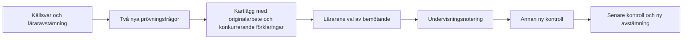

# E4: första innehållspaketet att granska

**Innehåll och arbetsgång godkända av Simon 2026-11-05 (”Kör på det”). Appintegration byggd och verifierad lokalt; därefter publicerad via PR #39. Ingen verklig elevutdelning verifierad.**
Se [publiceringskvittot](releases/2026-11-05-teacher-evidence-decimal-pilot.md)
för exakt commit och gränserna för produktionskontrollen. Nedanstående lokala
verifieringsanteckningar bevarar läget före publiceringen.
Ordningen följer systemsyntesen: täpp en konkret lucka inom aritmetik före nya
domäner. Befintlig v7 kan beräkna `decimal_parts_multiplied_separately`, men
saknar granskade bankfrågor. Ingen ny modell eller diagnostisk tröskel föreslås.

## Beslut 2026-11-05

Simon godkände följande innehåll och arbetsgång för det första pilotpaketet.
Innehållsgodkännandet innebär fortsatt varken automatisk elevdiagnos eller
utdelning till verkliga elever.

| Roll | Uppgift | Facit | Svar som komponentmodellen kan ge |
|---|---|---|---|
| Befintligt källexempel | 7 × 6,7 | 46,9 | 42,49 |
| Ny prövning A | 3 × 2,4 | 7,2 | 6,12 |
| Ny prövning B | 5 × 3,6 | 18 | 15,30 = 15,3 |
| Undervisningsexempel | 4 × 2,5 | 10 | 8,20 = 8,2 |
| Ny kontroll efter undervisning | 6 × 4,7 | 28,2 | 24,42 |
| Senare kontroll vid nytt tillfälle | 8 × 3,6 | 28,8 | 24,48 |
| Negativ kontroll | 2 × 3,4 | 6,8 | 6,8: skiljer **inte** modellen från rätt svar |

## Föreslagen arbetsgång

1. **Undersök:** granska originalet och avstämningen. Använd de två nya
   prövningsfrågorna bara om historiken tillåter det. Be eleven beskriva hur hen
   räknade och vad svaret betyder. Ge inga metodtips under denna prövning.
2. **Kartlägg:** notera om svaret passar komponentmodellen, en decimalförskjutning,
   annat räknesätt eller ingen känd modell. Ett matchande slutsvar avgör inte
   vilken metod eleven använde. Avskrivning, hjälp och avbrott måste hållas öppna.
3. **Bemöt vid belagd behovsbild:** föreslå ett samtal om heltal och tiondelar.
   Exempel: 4 × 2,5 = 4 × (2 + 0,5) = 8 + 2. Undervisningsförslaget är agentens
   didaktiska förslag, nu lärargranskat för piloten; det är ingen automatiskt vald
   intervention eller påstådd forskningsrekommendation.
4. **Kontrollera på nytt:** använd en annan uppgift efter undervisningen, senare
   ytterligare en vid nytt tillfälle. Anteckna vilken hjälp som faktiskt gavs.
   Ett nytt fel betyder inte automatiskt återfall; ett rätt svar betyder inte
   automatiskt självständig förståelse. Använd inte undervisningsuppgiften som
   nytt kontrollbelägg. Håll tiden för senare kontroll som ett lärarval.

## Avgränsning och belägg

Paketet gäller icke-negativt heltal gånger ett tal med **exakt en decimal**.
Det säger inget om två decimaltal, flera decimaler eller negativa tal. Svaren
är numeriska, så exempelvis 15,30 och 15,3 är samma svar. Den negativa kontrollen
visar konkret varför rätt svar inte ensamt kan utesluta komponentmodellen.

Modellens kod finns i `src/domains/arithmetic/errorHypotheses/multiplicationHypotheses.js`
och `src/domains/predictableErrors/arithmetic.js`. Det historiska källunderlaget
finns i [urvalsprinciperna](SCREENING_SELECTION_PRINCIPLES.md) och luckan i
[täckningsmatrisen](LEARNING_SYSTEM_COVERAGE.md). Inga nya påståenden om
förekomst, forskningsstöd eller säker diagnos görs här.

[Paketdata](evaluations/e4-decimal-multiplication-2026-11-04/package.json) och
[maskinbelägg](evaluations/e4-decimal-multiplication-2026-11-04/evidence.json)
är reproducerbara med:

```text
node docs/evaluations/e4-decimal-multiplication-2026-11-04/evaluate.mjs
```

Detta är en deterministisk syntetisk kontroll med öppet facit, **inte ett
blindtest**. Det tidigare Gemini-försöket saknade resultat på grund av kvot.
Ett nytt anrop 2026-11-05 gav inget svar inom tidsgränsen; inga externa
blindtestresultat påstås. De länkade provfilerna bevarar ursprungsprovets
daterade granskningsstatus från 2026-11-04.
Appens bankadapter och decimalrättning är nu lokalt implementerade.
Undervisningsnoteringar och kontrollobservationer lagras som nya, CAS-skyddade
avstämningar i den befintliga rapporten. Nya kontrollutkast går genom befintlig
materialgranskning och manuell utdelning. En elev/rapport åt gången.

Prövningsfrågorna har egna uppgifts-ID:n och versioner; undervisningsexemplet
och den negativa kontrollen väljs inte automatiskt som nya prövningar. Förhandsvisning, sparande och
godkännande av nya material läser tillgänglig historik från 2024 och avvisar redan mötta
frågor. Historikens fullständighet är fortsatt okänd. Publiceringsåterförsök
behåller sina frysta uppdragsidentiteter och gör ingen ny tilldelning av frågor
som redan har ett kvitto.

Nästa materialversion får koppla samma ursprungliga observation till en ny
källsnapshot när tillkommande svar ändrat snapshoten. Bindningen mellan gammal
och aktuell referens sparas. Ett ändrat ursprungligt elevarbete avvisas och
kräver en ny granskad rapport. Hjälpstatus är alltid en uttrycklig läraruppgift
med okänt som förval; ett rätt slutsvar ger ingen automatisk självständighets-
eller återfallsbedömning. Läraren väljer när ett senare kontrollutkast delas ut.

Övriga domänpaket och verklig klassrums-/iPad-verifiering återstår. Detta är
ingen produktions- eller generell E4-klarmarkering.



## Lokal verifiering 2026-11-05

- Full svit: 227 testfiler, 1 208 tester. Produktionsbuild och riktad lint/arkitektur gröna.
- 29 MCP-prov gröna; strikt validerat didaktikfält ger inga nya godkännande-/utdelningsbehörigheter.
- Nio berörda dev-browserprov gröna tillsammans, inklusive pilotens hela kedja och tidigare material-/rapportflöden.
- Slutligt pilotprov efter kontrollen av båda träningssamlingarna grönt.
- Verklig avstämningskonflikt, bevarad text och annan fliks mål, återläsning efter omladdning, två nya kontrollsteg och API-avvisning av redan mött fråga verifierade.
- Både vanlig träningshistorik och mastery är oförändrade i robotprovet.
- Faktisk render granskad stående/liggande i lokal Chromium-emulering. Ingen fysisk iPad, verklig elevutdelning eller produktion verifierad.

Första gemensamma körningen hade en kolliderande syntetisk elevidentitet mellan
två robotar. Piloten fick en egen lokal testidentitet; produktionsåtkomsten
ändrades inte. Därefter passerade samtliga nio prov tillsammans. Någon ny full
bred robotkörning påstås inte för detta avgränsade sjok.

Reproducerbar kärna:

```text
npm run test -- --exclude '**/.claude/**' --exclude '**/.codex/**'
npm run build
npm run mcp:test
```

Browserproven körs med `ROBOT_DEV=1`, en worker, och
`robots/didactic-decimal.robot.js`, `robots/followup-results.robot.js`,
`robots/pupil-analysis.robot.js`, `robots/material-review.robot.js` och
`robots/material-publication.robot.js`. Lokal minnesdatabas och syntetiska elever.
