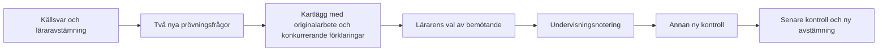

# E4: första innehållspaketet att granska

**Förslag för lärargranskning. Inte aktiverat i appens bank, inte utdelat.**
Ordningen följer systemsyntesen: täpp en konkret lucka inom aritmetik före nya
domäner. Befintlig v7 kan beräkna `decimal_parts_multiplied_separately`, men
saknar granskade bankfrågor. Ingen ny modell eller diagnostisk tröskel föreslås.

## Det konkreta beslutet

Är följande innehåll och lärararbetsgång ett rimligt första pilotpaket för att
undersöka komponentvis multiplikation av heltal och decimaldel? Godkännande av
innehållet innebär fortsatt varken automatisk elevdiagnos eller elevutdelning.

| Roll | Uppgift | Facit | Svar som komponentmodellen kan ge |
|---|---|---|---|
| Befintligt källexempel | 7 × 6,7 | 46,9 | 42,49 |
| Ny prövning A | 3 × 2,4 | 7,2 | 6,12 |
| Ny prövning B | 5 × 3,6 | 18 | 15,30 = 15,3 |
| Undervisningsexempel | 4 × 2,5 | 10 | 8,20 = 8,2 |
| Ny kontroll efter undervisning | 6 × 4,7 | 28,2 | 24,42 |
| Senare kontroll vid nytt tillfälle | 8 × 3,6 | 28,8 | 24,48 |
| Negativ kontroll | 2 × 3,4 | 6,8 | 6,8: skiljer **inte** modellen från rätt svar |

## Föreslagen arbetsgång

1. **Undersök:** granska originalet och avstämningen. Använd de två nya
   prövningsfrågorna bara om historiken tillåter det. Be eleven beskriva hur hen
   räknade och vad svaret betyder. Ge inga metodtips under denna prövning.
2. **Kartlägg:** notera om svaret passar komponentmodellen, en decimalförskjutning,
   annat räknesätt eller ingen känd modell. Ett matchande slutsvar avgör inte
   vilken metod eleven använde. Avskrivning, hjälp och avbrott måste hållas öppna.
3. **Bemöt vid belagd behovsbild:** föreslå ett samtal om heltal och tiondelar.
   Exempel: 4 × 2,5 = 4 × (2 + 0,5) = 8 + 2. Undervisningsförslaget är agentens
   didaktiska förslag och behöver lärargranskas; det är ingen automatiskt vald
   intervention eller påstådd forskningsrekommendation.
4. **Kontrollera på nytt:** använd en annan uppgift efter undervisningen, senare
   ytterligare en vid nytt tillfälle. Anteckna vilken hjälp som faktiskt gavs.
   Ett nytt fel betyder inte automatiskt återfall; ett rätt svar betyder inte
   automatiskt självständig förståelse. Använd inte undervisningsuppgiften som
   nytt kontrollbelägg. Håll tiden för senare kontroll som ett lärarval.

## Avgränsning och belägg

Paketet gäller icke-negativt heltal gånger ett tal med **exakt en decimal**.
Det säger inget om två decimaltal, flera decimaler eller negativa tal. Svaren
är numeriska, så exempelvis 15,30 och 15,3 är samma svar. Den negativa kontrollen
visar konkret varför rätt svar inte ensamt kan utesluta komponentmodellen.

Modellens kod finns i `src/domains/arithmetic/errorHypotheses/multiplicationHypotheses.js`
och `src/domains/predictableErrors/arithmetic.js`. Det historiska källunderlaget
finns i [urvalsprinciperna](SCREENING_SELECTION_PRINCIPLES.md) och luckan i
[täckningsmatrisen](LEARNING_SYSTEM_COVERAGE.md). Inga nya påståenden om
förekomst, forskningsstöd eller säker diagnos görs här.

[Paketdata](evaluations/e4-decimal-multiplication-2026-11-04/package.json) och
[maskinbelägg](evaluations/e4-decimal-multiplication-2026-11-04/evidence.json)
är reproducerbara med:

```text
node docs/evaluations/e4-decimal-multiplication-2026-11-04/evaluate.mjs
```

Detta är en deterministisk syntetisk kontroll med öppet facit, **inte ett
blindtest**. Gemini gav inget provresultat på grund av förbrukad kvot.
Appens bankadapter, versionshanterade undervisningsnotering och senare
kontrollkedja är ännu inte implementerade för detta paket. Därför ska detta
inte presenteras som en färdig ny elevfunktion.


