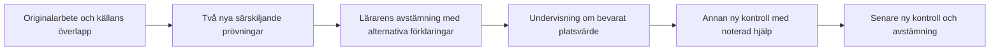

# E4: decimalsubtraktion med en växling — granskningsförslag

Status 2026-11-05: **förslag, inte godkänt innehåll eller aktiverad elevfunktion**.
Nästa lucka efter decimalmultiplikationspiloten. Ingen ny bankpost,
felmodell, diagnostisk tröskel eller ändrad progression införs i detta sjok.

## Luckan och ett motsägande fynd

V7 beräknar `smaller_minus_larger` och `borrow_forget` för decimalsubtraktion.
De befintliga bankvägarna gäller heltal; en heltalsfråga får inte tyst ersätta
decimalstrukturen. Se [täckningsmatrisen](LEARNING_SYSTEM_COVERAGE.md).

På **6,42 − 2,17** passar svaret **4,35** både större-minus-mindre i varje
kolumn och växling där tiondelen inte minskas. Det senare finns som
`exchange_not_decremented` för heltal, men saknas i decimalgrenen. Enbart
befintliga kodkandidater ger alltså inte hela den tänkbara bilden.
Paketets två prövningar skiljer därför även denna manuellt beräknade rival.
Det är ett matematiskt konstruerat alternativ, inte belägg för en elevs metod
eller för hur vanligt räknesättet är.

## Avgränsning och innehåll

Två decimaler i båda talen, positiva tal och positiv differens. Precis en
växling från tiondelar till hundradelar. Ingen växling genom noll eller över
heltalsgränsen. Olika antal decimaler, negativa tal och flera växlingar ligger
utanför paketet; ett senare rätt svar visar inte överföring till dessa fall.

| Roll | Uppgift | Facit | Större minus mindre | Noll där växling krävs | Växlar, minskar inte tiondelen |
|---|---|---|---|---|---|
| Källexempel | 6,42 − 2,17 | 4,25 | 4,35 | 4,30 | 4,35 |
| Ny prövning A | 7,53 − 2,19 | 5,34 | 5,46 | 5,40 | 5,44 |
| Ny prövning B | 8,41 − 3,24 | 5,17 | 5,23 | 5,20 | 5,27 |
| Undervisning | 5,32 − 1,18 | 4,14 | 4,26 | 4,20 | 4,24 |
| Ny kontroll | 9,54 − 4,28 | 5,26 | 5,34 | 5,30 | 5,36 |
| Senare kontroll | 6,83 − 2,47 | 4,36 | 4,44 | 4,40 | 4,46 |
| Negativ kontroll, ingen växling | 8,64 − 3,21 | 5,43 | 5,43 | 5,43 | 5,43 |

Hundradelar beräknas oberoende med heltal i granskningsskriptet. Den sista
raden är avsiktligt icke särskiljande: rätt svar utesluter ingen av reglerna.
Den ska aldrig väljas som ensam kontrast. Inte heller källexemplets felsvar
kan ensamt skilja de två överlappande förklaringarna.

## Föreslagen sammanhängande arbetsgång

1. Granska originaluppgiften, synligt räknearbete och tidigare läraravstämning.
   Fråga hur eleven tänkte och vad siffrorna betyder. Avskrivning, hjälp,
   inmatningsfel och andra metoder förblir möjliga förklaringar.
2. Använd två nya prövningar utan metodtips, efter kontroll mot tillgänglig
   historik. Notera faktiskt svar och arbete. Tomt, delvis ifyllt och avbrutet
   arbete är inte matematiska motbelägg. Även ett annat felsvar än tabellens
   alternativ ska bevaras utan påtvingad klassificering.
3. Vid lärarbedömt behov: undersök att **3 tiondelar och 2 hundradelar** kan
   skrivas som **2 tiondelar och 12 hundradelar**, med samma värde. I
   5,32 − 1,18 blir beräkningen då 12 − 8 hundradelar, 2 − 1 tiondelar och
   5 − 1 hela. Be eleven förklara varför tiondelen ändras. Detta är agentens
   didaktiska förslag för lärargranskning; inget påstått forskningsutfall.
4. Spara undervisning, hjälpstatus (okänt/gavs/ingen rapporterad), datum och
   observation i den befintliga rapportens avstämning. Undervisningsexemplet
   används inte som nytt kontrollbelägg.
5. Låt en annan uppgift prövas efteråt och ytterligare en vid ett nytt,
   lärarvalt tillfälle. Båda ska vara nya enligt tillgänglig historik och gå
   genom befintlig privat granskning/utdelning. Nytt rätt svar bevisar inte
   självständighet; nytt fel är inte automatiskt återfall. Kontroll inom samma
   snäva struktur skiljs från ännu oprövad överföring till andra strukturer.

## Granskning och rekommenderat genomförandebeslut

**Rekommendation:** godkänn paketets innehåll och arbetsgång, och komplettera
den befintliga decimalgrenen med den avgränsade rivalen innan paketet aktiveras.
Återanvänd heltalsmodellens identitet men gör decimalstödet explicit och
versionsmärkt. Låt inte en frånvarande modell visas som utesluten av data.
Granska även att negativkontrollen fortsätter ge rätt svar för samtliga regler.

Om detta godkänns återstår bankadapter, decimal-subtraktionsrättning och
paketval i befintlig undervisnings-/kontrollkedja, inklusive frysta modell-
varianter och historikskydd. Ingen ny uppdragslagring föreslås. Kräv först
ett robotprov som reproducerar den överlappande källobservationen och sedan
verifierar de två särskiljande prövningarna, sparad undervisning samt nya
kontrollutkast. Produktions- och verklig elevverifiering hålls separata.

## Reproducerbara belägg

[Paketdata](evaluations/e4-decimal-subtraction-2026-11-05/package.json),
[utvärdering](evaluations/e4-decimal-subtraction-2026-11-05/evaluate.mjs) och
[maskinbelägg](evaluations/e4-decimal-subtraction-2026-11-05/evidence.json).

```text
node docs/evaluations/e4-decimal-subtraction-2026-11-05/evaluate.mjs
```

Kontrollerar sju facit och tre alternativa kolumnberäkningar oberoende från
produktionsprediktorn, befintliga modellträffar, rättsvar och 14 delvis/tomt-
statusfall, två kontraster för vardera befintlig modell, källans överlapp och
den saknade decimalrivalen. Det är en syntetisk kontroll med öppet facit,
**inte ett blindtest eller lärargodkännande**. Inga verkliga elevdata används.


