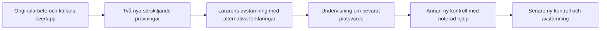

# E4: decimalsubtraktion med en växling — godkänt paket

Status 2026-11-05: **innehåll, arbetsgång och avgränsad rivalutökning godkända av Simon genom ”Ja, kör”. Lokalt verifierat och därefter publicerat via PR #40, master `4012ac4`.**
Det [daterade publiceringskvittot](releases/2026-11-05-decimal-subtraction.md)
redovisar integrerad regression med parallelltrådens arbete, exakt Vercel-bygge
och inloggad skrivfri förhandsvisning. Lokala prov nedan är skilda från dessa
produktionskontroller; ingen verklig elevutdelning eller fysisk iPad verifierad.
Paketet återanvänder rapportavstämning, materialgranskning och utdelningskvitto
från decimalmultiplikationspiloten. Ingen ny lagring, diagnostisk tröskel,
ändrad elevprogression eller verklig elevutdelning införs.

## Luckan och ett motsägande fynd

V7 beräknade `smaller_minus_larger` och `borrow_forget` för decimalsubtraktion,
men bankvägarna gällde heltal. V8 kompletterar `exchange_not_decremented`
inom paketets avgränsning, med samma modellidentitet som för heltal. Bankens
decimalfrågor och rättning är nu gemensamma för server och webbläsare.
Se [täckningsmatrisen](LEARNING_SYSTEM_COVERAGE.md).

På **6,42 − 2,17** passar svaret **4,35** både större-minus-mindre i varje
kolumn och växling där tiondelen inte minskas. Det senare finns som
`exchange_not_decremented` för heltal, men saknades i decimalgrenen före V8.
Paketets två prövningar skiljer nu även denna rival i kodens beräkningar.
Det är ett matematiskt konstruerat alternativ, inte belägg för en elevs metod
eller för hur vanligt räknesättet är.

## Avgränsning och innehåll

Två decimaler i båda talen, positiva tal och positiv differens. Precis en
växling från tiondelar till hundradelar. Ingen växling genom noll eller över
heltalsgränsen. Olika antal decimaler, negativa tal och flera växlingar ligger
utanför paketet; ett senare rätt svar visar inte överföring till dessa fall.
Det nya V8-stödet begränsas till ensiffriga heltalsdelar i båda operanderna.
Frågor utanför granskad struktur får inte tyst bytas mot paketets frågor.

| Roll | Uppgift | Facit | Större minus mindre | Noll där växling krävs | Växlar, minskar inte tiondelen |
|---|---|---|---|---|---|
| Källexempel | 6,42 − 2,17 | 4,25 | 4,35 | 4,30 | 4,35 |
| Ny prövning A | 7,53 − 2,19 | 5,34 | 5,46 | 5,40 | 5,44 |
| Ny prövning B | 8,41 − 3,24 | 5,17 | 5,23 | 5,20 | 5,27 |
| Undervisning | 5,32 − 1,18 | 4,14 | 4,26 | 4,20 | 4,24 |
| Ny kontroll | 9,54 − 4,28 | 5,26 | 5,34 | 5,30 | 5,36 |
| Senare kontroll | 6,83 − 2,47 | 4,36 | 4,44 | 4,40 | 4,46 |
| Negativ kontroll, ingen växling | 8,64 − 3,21 | 5,43 | 5,43 | 5,43 | 5,43 |

Hundradelar beräknas oberoende med heltal i granskningsskriptet. Den sista
raden är avsiktligt icke särskiljande: rätt svar utesluter ingen av reglerna.
Den ska aldrig väljas som ensam kontrast. Inte heller källexemplets felsvar
kan ensamt skilja de två överlappande förklaringarna.

## Godkänd sammanhängande arbetsgång

1. Granska originaluppgiften, synligt räknearbete och tidigare läraravstämning.
   Fråga hur eleven tänkte och vad siffrorna betyder. Avskrivning, hjälp,
   inmatningsfel och andra metoder förblir möjliga förklaringar.
2. Använd två nya prövningar utan metodtips, efter kontroll mot tillgänglig
   historik. Notera faktiskt svar och arbete. Tomt, delvis ifyllt och avbrutet
   arbete är inte matematiska motbelägg. Även ett annat felsvar än tabellens
   alternativ ska bevaras utan påtvingad klassificering.
3. Vid lärarbedömt behov: undersök att **3 tiondelar och 2 hundradelar** kan
   skrivas som **2 tiondelar och 12 hundradelar**, med samma värde. I
   5,32 − 1,18 blir beräkningen då 12 − 8 hundradelar, 2 − 1 tiondelar och
   5 − 1 hela. Be eleven förklara varför tiondelen ändras. Detta är agentens
   didaktiska förslag för lärargranskning; inget påstått forskningsutfall.
4. Spara undervisning, hjälpstatus (okänt/gavs/ingen rapporterad), datum och
   observation i den befintliga rapportens avstämning. Undervisningsexemplet
   används inte som nytt kontrollbelägg.
5. Låt en annan uppgift prövas efteråt och ytterligare en vid ett nytt,
   lärarvalt tillfälle. Båda ska vara nya enligt tillgänglig historik och gå
   genom befintlig privat granskning/utdelning. Nytt rätt svar bevisar inte
   självständighet; nytt fel är inte automatiskt återfall. Kontroll inom samma
   snäva struktur skiljs från ännu oprövad överföring till andra strukturer.

## Beslut och lokal implementation

Simon godkände paket, arbetsgång och avgränsad rivalutökning efter visad
Mermaid-arbetsgång. Den nya regelversionen är `predictable-errors-v8`.
Ingen frånvarande modell får visas som utesluten av data. Negativkontrollen
ger fortsatt rätt svar för samtliga tre regler.

Bankadapter, decimalrättning och paketval är lokalt byggda. Bara paketets två
kontraster får väljas automatiskt för någon av de tre modellerna. Undervisnings-
och kontrolluppgifter är reserverade för sina egna steg. Paket/rapport/hypotes
och noteringsversion kontrolleras på servern; olika paket får inte blandas.
Även källuppgifternas struktur kontrolleras på servern. Heltalsuppföljningen
kräver inte plötsligt en sparad didaktikrapport.

Material fryser V8:s modellvarianter och rivaler. Äldre utdelade material
använder sina frysta jämförelser; nya kandidater visas separat. Nya utkast
kräver aktuell regelversion. Decimalstödet påverkar inte elevappens äldre
felkategorier eller mastery. Facit inom paketets avgränsning räknas med
heltalshundradelar, så kontrollens 5,26 inte visas med flyttalsartefakter.
Produktions- och verklig elevverifiering hålls separata.

## Reproducerbara belägg

[Paketdata](evaluations/e4-decimal-subtraction-2026-11-05/package.json),
[utvärdering](evaluations/e4-decimal-subtraction-2026-11-05/evaluate.mjs) och
[maskinbelägg](evaluations/e4-decimal-subtraction-2026-11-05/evidence.json).
Det ursprungliga V7-fyndet om den saknade rivalen bevaras i
[förslagsbelägget](evaluations/e4-decimal-subtraction-2026-11-05/proposal-evidence-v7.json).

```text
node docs/evaluations/e4-decimal-subtraction-2026-11-05/evaluate.mjs
```

Kontrollerar sju facit och tre alternativa kolumnberäkningar oberoende från
produktionsprediktorn, befintliga modellträffar, rättsvar och 14 delvis/tomt-
statusfall, två kontraster för var och en av de tre modellerna, källans
överlapp och den implementerade decimalrivalen. Paketdata jämförs med den
verkliga appkatalogen. Det är en syntetisk kontroll med öppet facit,
**inte ett blindtest eller empiriskt belägg för en elevmetod**. Lärargodkännandet
kommer från Simons separata innehållsbeslut. Inga verkliga elevdata används.



## Lokal verifiering 2026-11-05

- 228 testfiler / 1 214 tester och produktionsbuild gröna på slutversionen.
- 29 MCP-prov gröna; adaptergränsen för godkännande och utdelning är oförändrad.
- Tio relevanta browserfall gröna tillsammans med en worker och `ROBOT_DEV=1`,
  noll rapporterade regelbrott: båda decimalpaketen, uppföljningsresultat,
  rapportavstämning, granskning och samtliga tolv material-/utdelningskombinationer.
- Subtraktionsprovet kontrollerar frysta trevägsvarianter och olösta par,
  decimalrättning, verklig avstämningskonflikt utan förlorad text/mål,
  omladdning, sparad hjälpstatus, två nya kontrollsteg, serveravvisning av
  redan mött kontroll samt oförändrade `masteryFacts` och `problemLog`.
- Negativa enhetsprov avgränsar nollkedja, flera växlingar, olika decimalantal,
  större heltalsdelar, andra paket och äldre frysta modellsvar.
- API-entrymodulerna importerade direkt utan fel; riktad lint och
  arkitekturkontroll gröna. Faktisk render granskad stående/liggande i Chromium.

Det nya browserprovet kördes först rött på den saknade bankuppgiften.
Under utvecklingen fick en körning stopp vid senare inlämning; slutversionens
subtraktionsprov passerade därefter. En annan körning fick timeout vid första
testdataseed under samtidiga enhetstester/build. Den slutliga separata
omkörningen passerade alla tio browserfall tillsammans. Detta är ingen ny
full bred robotkörning, inget externt blindtest och ingen autentiserad
produktions-, fysisk iPad- eller verklig elevverifiering.

```text
npm run test -- --exclude '**/.claude/**' --exclude '**/.codex/**'
npm run build
npm run mcp:test
```

Browserurval med `ROBOT_DEV=1`, en worker och separat ledig `ROBOT_PORT`:
`didactic-subtraction.robot.js`, `didactic-decimal.robot.js`,
`followup-results.robot.js`, `pupil-analysis.robot.js`, `material-review.robot.js`
och `material-publication.robot.js`. Syntetiska elever och lokal minnesdatabas.
