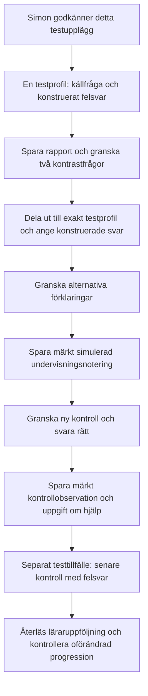

# E4: avgränsad produktionspilot

Förberedd 2026-11-05 efter Simons ”Kör”. Simon godkände genomförandet genom
”godkänt”. Åtkomstprov påbörjat; körningen hindras för närvarande av
webbläsarstyrning och skild kontoidentitet enligt status nedan. Inga material,
rapporter, elevsvar eller avstämningar har sparats. Ingen utdelning har skett.

## Syfte och mottagare

Pröva överlämningarna i den publicerade lärarkedjan för decimaladdition:
källsvar → alternativa förklaringar → kontraster → undervisningsnotering →
ny kontroll → senare kontroll. Detta är ett tekniskt scenario med konstruerade
svar och simulerad undervisning, inte ett blindtest, elevdiagnos eller belägg
för undervisningseffekt.

Föreslagen mottagare är en enda befintlig testprofil i **Test – felmönster**.
Projektkartans tidigare valideringsbelägg beskriver klassens åtta egna profiler.
Aktuell klass, enskild mottagare och lärarkontot adminperson har återlästs;
exakt mottagarbindning hålls i privat körunderlag utanför Git.
Ingen annan klass eller elev ingår. Befintlig testhistorik ska bevaras.

## Konkreta steg efter godkännande

| Steg | Fråga eller handling | Konstruerat svar / förväntat resultat |
|---|---|---|
| 1. Startunderlag | En separat screening med `decimal-add-source`: 3,48 + 2,67 | Ange 6,05. Facit 6,15. Kandidaten en tappad minnessiffra får prövas; alla tappade ger 5,05. |
| 2. Rapport | Öppna testprofilens Analys och avstämning, välj screening och spara aktuell rapportversion | Rätt källa och hypotes binds till rapporten; inget diagnosbesked. |
| 3. Kontraster | Skapa, granska och dela ut de två kontrastfrågorna genom befintlig materialvy | 1,76 + 2,58: ange 4,24 (facit 4,34). 4,67 + 1,85: ange 5,52 (facit 6,52). |
| 4. Frysta alternativ | Läs materialets prövningsavsikt och resultat | En tappad: [4,24; 3,34] respektive [6,42; 5,52]. Alla tappade: 3,24 respektive 5,42. Båda positionerna måste bevaras. |
| 5. Simulerad undervisning | Läs bemötandet med 2,68 + 1,57 = 4,25 och spara undervisningsnotering | Text ska börja ”SIMULERAD TESTNOTERING:”. Hjälp anges given. Kontrollera förklaringen av 15 hundradelar och 12 tiondelar. |
| 6. Ny kontroll | Skapa, granska och dela ut `decimal-add-independent_check`: 3,86 + 2,47 | Ange 6,330. Bedöms som rätt (6,33). Spara uttrycklig simulerad kontrollobservation med ingen hjälp enligt läraren. |
| 7. Senare kontroll | Skapa, granska och dela ut `decimal-add-later_check`: 1,78 + 3,66 | Ange 4,44. Facit 5,44. Resultatet får öppna ny lärarfråga, inte automatiskt fastslå återfall. |
| 8. Återläsning | Ladda om rapport, avstämningar och utdelningskvitton | Rätt elev, version, hypotes, hjälp och historik finns kvar. Vanlig mastery och träningslogg är oförändrade. |

Steg 7 körs vid ett separat testtillfälle. Om båda kontroller körs samma dag
verifieras endast appens senare-kontrollväg; ingen fördröjd retention påstås.
Det negativa exemplet 2,13 + 3,24 = 5,37 granskas i bemötandet: rätt svar där
kan inte skilja de två minnessiffermodellerna och ska inte räknas som motbevis.

Varje material granskas i sin aktuella version med exakt en mottagare före
utdelning. Den skrivfria samlingspreviewen nedan får **inte** delas ut som ett
sjufrågepaket: då skulle framtida kontrolluppgifter redan vara mötta.
Nya kontroller måste godkännas av serverns historik-/nyhetskontroll. Om de
redan är mötta stoppas försöket; historik rensas inte och spärrar kringgås inte.

## Klart när

- Hela kedjan har återlästa kvitton och versionsbundna överlämningar i produktion.
- Frågevisning, sparat svar och inlämning är åtskilda; rätt svar blir inte ett
  automatiskt påstående om metod eller självständighet.
- Alla alternativa modellsvar visas korrekt och simulerade noteringar är märkta.
- Ingen annan profil har påverkats och vanlig progression är oförändrad.
- Avvikelser dokumenteras med reproduktion; tekniskt fel rättas innan nästa steg.

Ingen automatisk radering eller återställning ingår. Testmaterial och märkta
noteringar behålls som spårbar historik. Eventuell städning blir ett eget beslut.
Fysisk iPad och verklig undervisningsutvärdering är separata prov.

## Faktiskt verifierat under förberedelsen

Aktuella capabilities ger `materialPreview=true`, rätt kontobindning och
`assignmentPublication=false` i MCP. Produktionens skrivfria materialpreview
accepterade sju uppgifter/version 1 med facit 6,15; 4,34; 6,52; 4,25; 6,33;
5,44; 5,37. Kvittot gav `saved:false`, `assigned:false`,
`approval:not_requested`. Exakt previewrevision finns i privat körunderlag;
den binder endast denna osparade preview, inte kommande rapport eller utdelning.

Den fulla lokala förebilden är `robots/didactic-addition.robot.js`; senaste
publiceringsbelägg finns i `releases/2026-11-05-decimal-addition.md`.
Produktionens lärar-/elevinloggning i webbläsare och hela skrivkedjan är ännu
inte verifierade under denna förberedelse. MCP stöder inte godkännande,
utdelning eller läraravstämningar; dessa steg ska ske genom betrodd inloggning
och befintligt granskningsflöde. Ingen alternativ endpoint ska kringgå det.

## Genomförandestatus efter godkännandet

- Aktuella MCP-capabilities bekräftar fortsatt pilotägaren adminperson och
  samma uttryckliga kontobindning. Godkännandet av testupplägget behöver inte
  begäras igen.
- In-app-anslutningen nekas med saknad betrodd native bridge. Chromes
  flikanslutning kan skapa tomma flikar men navigation/åtkomst misslyckas med
  ett internt timeoutMs-fel. Native styrning når en separat matteflik, men
  elementklick misslyckas med saknad koordinatgeometri.
- Tillgänglighetsinformationen visar lärarvyn inloggad som **Adminsimon**,
  huvudadmin, medan MCP uppger **adminperson**, school_admin. Samma ägare är
  därmed inte verifierad. Inga privata pilotutkast skapas under fel konto.
- Helbild av Chrome avvisades av automatisk säkerhetsgranskning eftersom
  andra privata flik-/kontouppgifter kan exponeras. Ingen bild togs; fortsatta
  observationer använde tillgänglighetsinformation.
- Skrivfri läsning av just testprofilens screeninghistorik för 2026-11-05 gav
  noll poster i perioden, tolv indexerade försök och okänd indexfullständighet.
  Detta bevisar inte att kontrollfrågorna är omötta. Bredare läsning begränsades
  av svarsstorlek; nyhetskontrollen är ännu inte passerad.
- Nästa åtgärd: återställ fungerande, isolerad webbläsaråtkomst på rätt
  lärarkonto och fortsätt från steg 1. Ingen alternativ endpoint, ändrad
  säkerhetspolicy eller ny utdelning har använts för att kringgå hindret.

