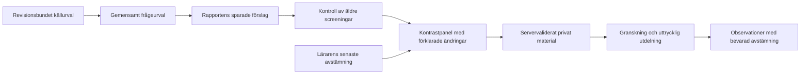
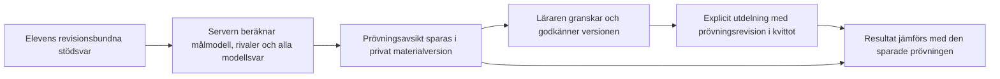
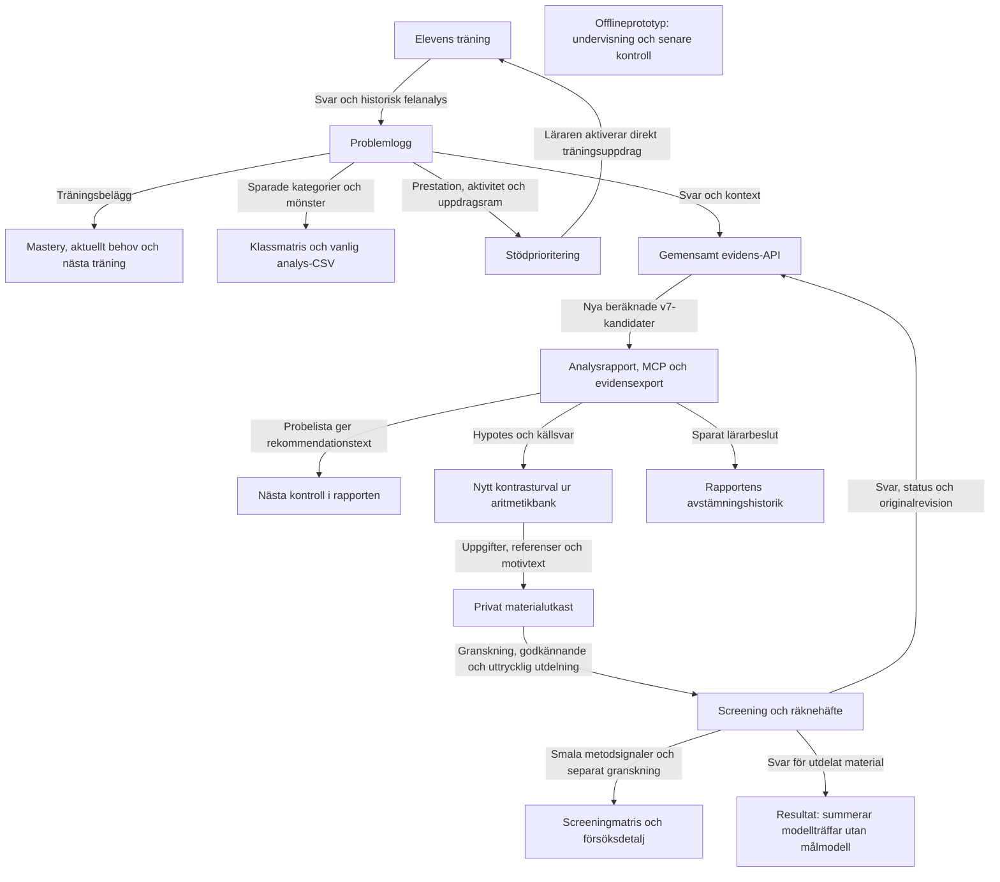
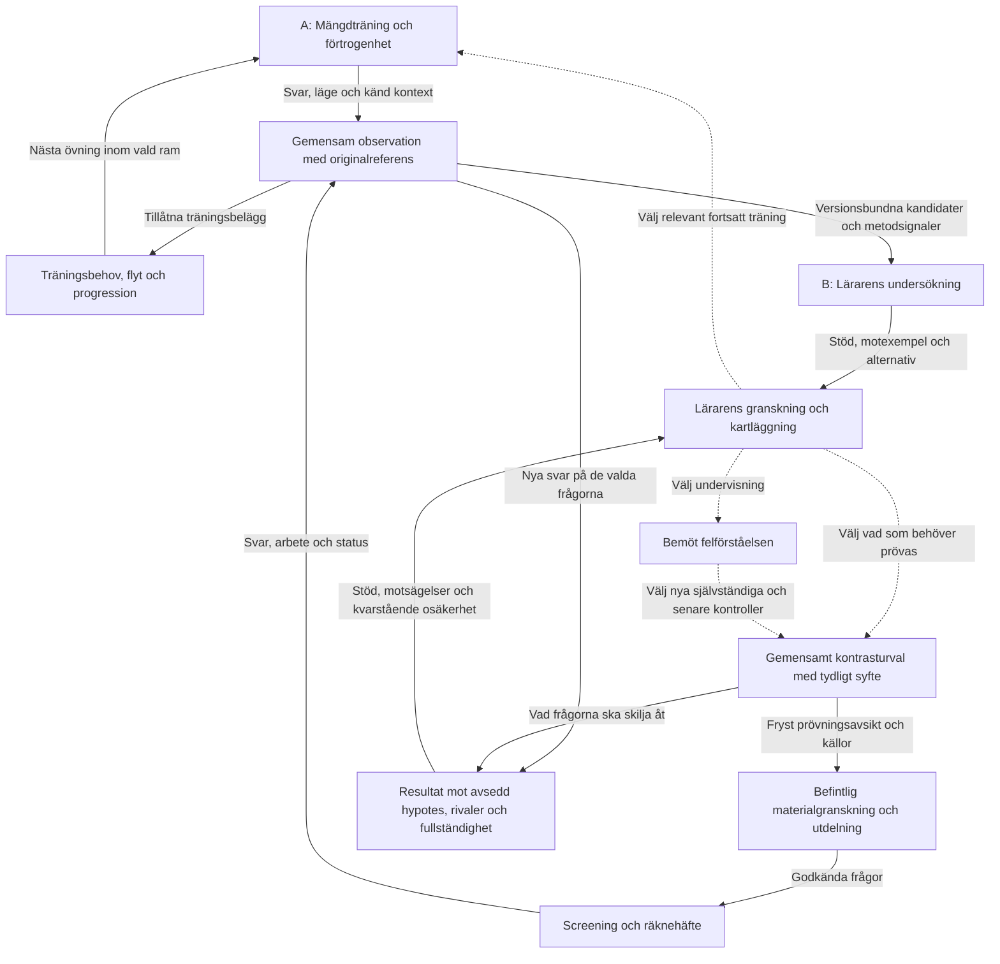

# Två mål, en sammanhängande app

Datum: 2026-11-04. **Genomförd kod- och dokumentgranskning; föreslagen genomförandeordning.**
Inspekterad kod i ursprungsinventeringen: `82ab3325f8d475885381fe5db85c019834faf5c5`. Själva inventeringen ändrade ingen appfunktion.
Målen är preciserade av Simon i samtalet och införda i [produktkontraktet](PRODUCT_CONTRACT.md).
Arkitekturförslagen nedan är rekommendationer; genomförda etapper anges separat.

### Produktionsstatus 2026-11-05

E1–E3 och den godkända E4-decimalmultiplikationspiloten är publicerade via
PR #39, merge `c26de2c`, på Vercel **sekvens** / `matematik.ximon.se`.
[Publiceringskvittot](releases/2026-11-05-teacher-evidence-decimal-pilot.md)
skiljer lokal verifiering, gröna CI-kontroller och publik produktionskontroll
från ännu oprövad autentiserad användning och fysisk iPad. Lokala statusar
nedan beskriver verifieringen före denna publicering.

[Decimalsubtraktionspaketet](E4_DECIMAL_SUBTRACTION_REVIEW.md) är därefter
godkänt av Simon och lokalt implementerat med sju kontrollerade exempel och
två fyrvägskontraster. V8 kompletterar den tidigare saknade decimalrivalen;
källöverlapp och alla tre alternativa svar bevaras. Gemensamt paketregister,
servervaliderad avgränsning och samma rapport-/materialkedja används för båda
paketen. Ny undervisning och nya kontroller lagras fortsatt som befintliga
rapportavstämningar och privata materialutkast. Detta tillägg är inte i PR #39
eller produktion. Ingen generell E4-/domänfullständighet påstås.

### E4-pilot godkänd och lokalt implementerad 2026-11-05

Simon godkände innehåll och arbetsgång i
[E4_DECIMAL_MULTIPLICATION_REVIEW.md](E4_DECIMAL_MULTIPLICATION_REVIEW.md).
Paketet har nu sju egna bankuppgifter och en särskild decimalrättning med
bevarad råtext, decimaltecken och ofullständiga svar. V7:s matematiska modell
är oförändrad. Bara två kontrastfrågor ingår i det automatiska första urvalet;
paketets undervisnings-, kontroll- och negativa exempel hålls åtskilda.

Den befintliga rapportavstämningen lagrar versionsbundna undervisningsnoteringar
och kontrollobservationer med lärarens hjälpstatus. Ny kontroll och senare
kontroll blir privata materialutkast, med samma granskning och explicita
utdelning som tidigare. En elev/rapport åt gången. Samma ursprungliga stöd kan
bindas om till aktuella källreferenser efter tillkommande svar, men ändrat
originalarbete kräver en ny rapport. Exponeringskontrollen inkluderar båda
tillgängliga träningssamlingarna samt den valda klassens indexerade screeningar
sedan 2024. Det är en annan läsfråga än vilka bedömda observationer som räknas
i en rapportperiod. Historikens fullständighet förblir okänd.

Inga nya uppdragslager, automatiska diagnoser, tysta masteryändringar eller
MCP-behörigheter införs. Tidpunkt för senare utdelning väljs av läraren.
Undervisningsnoteringar kan läsas från rapportens avstämningshistorik och
material/resultat, så att de kompletterande lagren behåller sina referenser.

Hela pilotkedjan är provad i lokal webbläsare, inklusive verklig versionskonflikt
mellan lärarflikar, återläsning efter omladdning, två nya kontroller, negativa
API-provet för redan mött uppgift och bevarad träningshistorik/mastery.
Full svit/build, regressionsstatus och exakta antal redovisas i projektkartan.
Faktisk render har granskats stående/liggande i Chromium-emulering.
Gemini gav inget svar inom tidsgränsen 2026-11-05; inga nya externa blindtest-
eller granskningsresultat påstås. E4:s övriga domänpaket, verklig klassrums-/
fysisk iPad-provning återstår. Produktionspubliceringen är därefter verifierad
enligt kvittot ovan.

### Lokalt byggt och verifierat: E3

`followUpSelection` använder nu samma rena urval för evidensens probeprojektion,
rapportens rekommendation och kontrastpanelen. Aritmetik använder granskade
bankversioner. Övriga domäners befintliga prober är uttryckligen lärarråd utan
utdelningsbar bankversion. Alla svarsalternativ räknas, med olösta modellpar synliga.
Rapporten sparar sitt urval och exkluderade frågefingeravtryck, även när alla
källsvar inte ingår i rapportens exempel. Kontrastpanelen kontrollerar dessutom
screeningar från 2024 till idag med fixerad period, revision och loopskydd. Ett
ändrat urval förklaras. Träningshistorik utanför källperioden är fortsatt okänd.

En sparad rapport överlämnar rapport-/hypotesreferens och senaste avstämningsrevision.
Servern läser lärarens egen rapport, kontrollerar källurval, modell och referenser
och fryser lärarens tolkning i materialversionen. Ändrad/avfärdad hypotes kräver
ett uttryckligt nytt lärarval för att pröva originalmodellen. Tolkning och mål
visas i rapport, materialgranskning och resultat. En ändrad avstämning gör en
gammal överlämning inaktuell; inget tolkas tyst som godkänt. Osparade rapporter
kan fortfarande ge privata prövningsutkast utan uppfunnen avstämning.

Verifierat lokalt: roboten visade först att rapportens 62−27 inte följde med
till utkastet. Efter rättning passerar fem berörda browserprov, inklusive
reviderad tolkning och uttryckligt återöppnande genom hela materialkedjan.
222 testfiler/1 191 tester passerar. Renderad kontrastpanel har granskats.
Därefter byggdes E3:s gemensamma metodsignaler och försöksgranskning, separat
versionsbundna från originalsvaret och bevarade till material/resultat.
Strikt och utökad häftesläsning hålls isär. Äldre okänt arbetsformat förblir
okänt och originalet läsbart. Strukturellt jämförbara heltalsscreeningar kan nu
ge möjliga motexempel utan uppfunna träningsnivåer. Decimaler/negativa tal får
ingen sådan reservjämförelse. Kända olika nivåer jämställs inte.

Klassens felunderlag, rapport/evidens och CSV använder samma aktuella
kandidatberäkning, träningskällval och kanoniska observationsläsning. Identiska
versioner med samma observations-id räknas en gång; konflikter och legacyrader
utan säkert id bevaras. En robot visade först två kandidatsvar i klassvyn mot
ett i evidens-API:t och passerar efter samordningen. Historiska etiketter, slutsvarsbedömning
och original bevaras; klassvyn skiljer aktuella kandidater från historiska
markeringar och visar observations-id. Stödlistans prioritet och direkt
aktiverade Fokus/Värm skiljs från elevvyns undersökning. Träningens adaptiva
policy, elevens sparande och behörigheterna ändras inte.

E3:s slutliga fulla enhetssvit: 224 filer/1 200 tester gröna. Nya likhetsprov för
klass/rapport/CSV och källreferensstabilitet passerar, liksom webbläsarprovet för
klassdetaljen och hela överlämningen med försöksanteckning, ändrad tolkning och
explicit återöppnande. Historikloop stoppar urval och erbjuder återförsök.
Build och riktad lint/arkitektur passerar. JSON-importerna har samma explicita
typ i Node och webbläsaren; ESLint läser ES2025-syntaxen. Slutliga 29 MCP-prov passerar även efter dubbletträttningen.

Den breda produktionslika robotkörningen gav 176 godkända, sju fallerade och
sex överhoppade prov. Exakt de sju fallen passerade seriellt (bland annat
API-tidsgränser och en återställd seedanslutning). Detta är ingen obrutet grön
helsvit. Efter sista rättningen passerar även sex berörda dev-browserprov för
rapport, klassdetalj och hela överlämningen, inklusive ursprunglig
försöksgranskning, historikloop och återförsök. Testets försöksgranskning väntar
nu på elevens bekräftade inlämning, så en pågående slutskrivning inte orsakar
en korrekt revisionskonflikt i provet. Faktisk render i stående och liggande
har granskats. Ingen push, produktion, verklig elev eller fysisk iPad-provning.

E4:s första konkreta innehållsförslag finns i
[E4_DECIMAL_MULTIPLICATION_REVIEW.md](E4_DECIMAL_MULTIPLICATION_REVIEW.md).
Sju föreslagna uppgifter är oberoende aritmetiskt kontrollerade och prövade
mot v7, med rätta svar, skalningsalternativ, partiella/obesvarade svar och
en icke-särskiljande negativ kontroll. Detta är inte ett blindtest eller en
aktiverad bankfunktion vid inventeringstillfället 2026-11-04. Senare godkännande
och lokal integration 2026-11-05 redovisas överst; de historiska maskinbeläggen
har inte skrivits om till nya leveranspåståenden.



### Senare genomförande samma dag: E1

Simon gav därefter mandat att gå vidare. E1 rättar operatorn i kontrastvisningen,
skiljer bedömda svar från inlämning och hela materialversionens frågeantal,
stoppar ofullständig historikläsning och erbjuder uttrycklig omläsning/återförsök.
Resultatvyn använder den sparade materialversionen även när en ny förhandsvisning
visas. Flera mottagare kan läsas var för sig. Alla konkurrerande modellträffar
redovisas som observationer; ingen ”för/emot misstanken”-summering görs utan
strukturerad prövningsavsikt. Screening utan apptips likställs inte med känd
självständighet. Befintlig materialgranskning och elevens svar bevaras.

Fynden F03–F08 nedan beskriver ursprungsbaslinjen. E1 rättar F08 och resultatdelen
av F04, samt undviker den ogrundade slutsatsen i F03. E2 behövs fortfarande för
att faktiskt binda resultatet till avsedd hypotes och rivaler. F01/F02/F05/F06/F07
är inte lösta av E1. Ingen push, produktion eller verklig elevprovning ingår.

Två robotprov visade först produktfelen röda: ett sparat rätt svar gav ”talar
emot misstanken”, och multiplikationskontrasten visade `146 + 4`. Efter rättning
passerar sju berörda browserprov inklusive ofullständig sidläsning och explicit
återförsök. 219 testfiler/1 177 tester, produktionsbuild, riktad lint och
arkitekturkontroll passerar. Renderade delresultat och inlämnade svar har granskats.
Den breda robotkörningens slutstatus dokumenteras i projektkartan.

Den breda körningen hittade även en reproducerbar R2-avvikelse i tabellvyn:
sparad jämförelseelev rensades under katalog-/resultathämtningen vid omladdning.
`DashboardLayout` väntar nu på färdig resultatläsning innan ett val förklaras
vara utanför urvalet. Ett uttryckligt byte till annan klass rensar fortfarande
valet efter färdig hämtning. Befintlig tabellrobot var röd även seriellt före
rättningen. Ändringen bevarar spår A och inför ingen ny matematisk policy.

### Senare genomförande: E2

Prövningsavsikten följer nu nya kontrastutkast genom servervaliderad preview,
sparad version, synlig granskning, godkännande och utdelningskvitto till resultat.
Varje mottagare har egen revisionsbunden analysgrund. Resultatet skiljer avsedd
modell och rivaler från andra träffar i aktuell analys och läser frysta modellsvar.
Äldre material förblir observationer utan påhittad prövningsavsikt.

Vid implementationen upptäcktes att en modell kan ha flera svar, exempelvis
615 eller 525 för 357+268 när olika minnessiffror glöms. Bankurvalet och den nya
prövningsplanen använder nu en gemensam variantberäkning i stället för första
träffen. Rivalen vänster-till-höger för 107+903=10 hittas även när den överlappar
en senare variant av glömd minnessiffra. Bankkontraster räknas som särskiljande bara
när svarsmängderna inte överlappar. E3:s två separata frågeväljare och övriga
överföringar är fortfarande kvar att samordna.

Kontrakt och bakåtkompatibilitet: [materialkontraktet](PUPIL_MATERIAL.md).
E2 innebär ingen produktion, verklig elevprovning, ändrad åtkomst eller mastery.

Verifierat för E2: full svit 220 filer/1 185 tester, 29 MCP-prov, åtta berörda
browserprov mot isolerad minnesdatabas, build, riktad lint och arkitektur.
Därefter passerar 16 riktade modell-/kontrastprov inklusive ett nytt positivt
fler-elevfall med olika källor och rivaler. Slutligt browserprov täcker även
motstridigt facit, dolt sammanfattningsbesked och återförsök. Prövningsavsikten
har granskats i stående och liggande render. Den första E2-browserkörningen
stannade i seed-timeout före appflödet; den efterföljande åttafallskörningen
passerade. E1:s breda robotkörning är fortsatt inte en obruten grön fullkörning.



## 1. Målet som varje ändring ska återvända till

**A: mängdträning och förtrogenhet.** Eleven befäster kunnande, säkerhet och flyt genom praktisk övning. Tabeller, talpar och dubblor är centrala exempel. Bevara deras fungerande elevflöden.

**B: utforska och bemöta felförståelser.** Gör det enkelt för läraren att upptäcka en misstanke, undersöka elevens tänkande, kartlägga vad som behöver bemötas, välja undervisning och följa upp självständig förståelse.

De samverkar genom spårbara observationer och uttryckliga lärarbeslut. Enstaka fel, lång svarstid eller en beräknad modellträff fastställer ingen felförståelse. Diagnostik ändrar inte tyst träningens mastery. Andra befintliga träningsområden finns kvar; de två spåren är syften, inte en ny menyindelning.

Varje kommande ändring ska ange **mål → konkret hinder → ansvarig del → berörda överlämningar → observerbart bevis**. Fler regler, fler kort och fler frågor är inte egna framgångsmått.

## 2. Hur granskningen gjordes och vad den belägger

Läsordning: projektkonstitution, arkitektur, utvärdering, produkt-/funktionskontrakt, NCM-riktning, aktuell projektkarta och relevanta analys-/materialdokument. Därefter följdes producenter och konsumenter i kod samt befintliga tester. Alternativa implementationsvägar söktes uttryckligen; en dokumentrubrik eller första kodträff räknades inte som leveransbevis.

Alla sex registrerade domäners vanliga felanalys och beräknade kandidatmotor har lästs. Rapport-, klassmatris-, räknehäftes-, material-, API-, export- och MCP-vägar har jämförts. Träningens registrering, aktuellt behov, progression och tabelluppföljning har följts för att skilja avsiktlig separation från oavsiktlig isolering.

[Täckningsmatrisen](LEARNING_SYSTEM_COVERAGE.md) redovisar varje explicit kandidat-ID per domän, kompletterande räknehäftessignal och de äldre inventerade signalerna. [Körbara belägg](evaluations/learning-synthesis-2026-11-04/evidence.json) innehåller filhashar och konstruerade exempel. Återskapa utan nätverk, inloggning eller skrivning från skriptet:

```text
node docs/evaluations/learning-synthesis-2026-11-04/reproduce.mjs
```

Sökningen omfattar 8 500 konstruerade problem och 62 domän/modell-par. Den visar att ett exempel finns eller inte hittades i just denna sökning; den bevisar inte didaktisk giltighet, fullständig domän-/situations-/rival-/historiktäckning eller faktisk användaråtkomst. Räknehäftessignalen `notebook_answer_mismatch` ligger utanför dessa 62 och redovisas separat.

Efter E1 är körskriptet ett historiskt baslinjeprov: dess assertions stoppar
avsiktligt när de gamla felbeteendena inte längre finns. Frysta `evidence.json`
är belägg från inventeringens kodrevision, inte en ny körning på rättad kod.
Nya beteenden verifieras av appens enhets- och robotprov; skriv inte över de
historiska felen med nya resultat och kalla dem samma inventering.

Inga verkliga elevdata, produktionsanrop, behörighetsändringar eller utdelningar ingår. Kodens administratörs-/pilotgränser har lästs; deras aktuella produktionskonfiguration har inte hämtats. Publiceringskvitton från tidigare arbete är historiska belägg, inte ny verifiering av allt i denna rapport. Ingen långsiktig lärandeeffekt eller fysisk iPad-verifiering påstås.

Verifierat i denna leverans: 7 befintliga testfiler/62 tester för kandidat/probe, kontrasturval, rapporthypoteser, lägespolicy, uppföljningssignal, evidensåtkomst och materialpreview passerar. Deras nuvarande förväntningar kan vara gröna samtidigt som F03–F08 kvarstår; de konstruerade beläggen visar just luckor utanför testernas anspråk. Reproduktionsskriptets assertions låser granskningens baslinje, inte ett önskat framtida beteende. Build och elevrobotar körs inte för denna dokumentleverans; appkod är oförändrad. Projektkartans vanliga och staged strukturkontroll samt dokumentlänkar kontrolleras före commit.

### Funktionsinventering: producerar, använder och avgränsar

| Del och åtkomstväg | Producerar | Konsument och överlämning | Bedömning |
|---|---|---|---|
| Elevens träning: `usePracticeCoreActions` → `studentProfile.addProblemResult` → domänens `evaluate`/`analyzeError` | Svar, kontext, historisk kategori och felmönster; WAL-händelser | Lokal historik/synk, mastery, aktuellt behov, lärarsammanfattning | Bevara snabb registrering och original. Gamla kategorier kan påverka anpassning; de är inte bara presentation. |
| `masteryCalculation`, `masteryFacts`, `currentNeed`, `adaptationDecision` | Historiskt belägg, aktuellt träningsbehov, versionsmärkt avancering | Elevens nästa steg och lärarunderlag | Kompletterande ansvar, inte fyra kopior av samma beslut. Kontrollera ansvar mot F2/F5 innan förenkling. |
| Tabellkö och `tableDrillCompletion`/`tablePracticeProgress` | Omförsök sist i kön, avslutade rundor, faktorbredd och ostörd svarstid | Elevens träning och lärarens tabellöversikt | Eget flytunderlag; avslutad tabell är inte generell multiplikationsmastery. Ingen ny tabellmotor behövs för syntesen. |
| Träningsbaserad klassmatris och CSV via `teacherAnalytics` | Urval, kategorier, sparade mönster och exempel | Klassöversikt/export | Använder inte automatiskt lärarrapportens nya kandidatprojektion. Samma ord kan därmed stå för olika analysnivåer. |
| Stödprioritering via `buildRiskSignals` och `SupportPriorityPanel` | Prestations-/aktivitets-/uppdragsignaler, konkreta felsvar och föreslaget nästa steg | Elevdetalj eller snabbuppdrag Fokus/Värm | Prioriterar vem läraren bör titta på, fastställer inte matematisk felorsak. En annan legitim ingång än analysrapporten. |
| `dashboardAssignmentActions.handleCreateQuickAssignment` | Direkt skapat och aktivt träningsuppdrag, eventuell kopierad klasslänk | Befintlig uppdragslagring och elevens träning | Har inte materialutkastets förhandsgranskning eller analysgrund. Klasslänk är inte fryst individuell mottagarlista. |
| NCM-översikt via `ncmSkillMap`/`buildNcmDetailForStudent` | Innehållskod, område, rättandel och kategorier från träningsloggen | NCM-översikt/elevdetalj | Kompletterar felmodeller med innehållsförankring; NCM-kod är inte en felorsak. |
| Screening: `diagnosticObservation`, försökslager och lärardetalj | Slutsvar, status, originalrutnät/händelser och separat granskningsnotering | Screeningmatris, elevdetalj och underlags-API | Bevara separat `diagnostic_only` och original. Metodsignaler är smala och egna. |
| `readPupilEvidence` → `evidencePage` → `addPredictableEvidence` | Revisionsbundet gemensamt läsunderlag med nya v7-kandidater | Rapportutkast, API/MCP och evidensexport | Redan gemensam koppling mellan träning och screening. Beräknar nya kandidater utan att skriva om originalbedömningen. |
| `buildRuleHypotheses` → `buildPupilAnalysisDraft` → rapportvalidering | Grupperade kandidater, stöd, jämförbara motexempel och begränsningar | Analys och avstämning i elevprofil, rapportlager och MCP | Bra spårbarhet; begränsat urval och metadata påverkar vilka slutsatser som alls kan visas. |
| `AnalysisCheckInForm` → rapportens `checkIns` | Lärarens accepterade/reviderade/avfärdade arbetshypotes och nästa mål | Rapportalternativ och historik, läsbart via MCP | Beslutet finns men följs inte strukturerat in i kontrastutkastet. |
| `selectPredictableProbe` → `nextProbe` → `nextCheckSv` | En strukturerad kontrollfråga, sedan en textrekommendation | Rapport/API/MCP | Förslagssystem 1; ingen direkt utdelning. Rapporttexten är inte ett beständigt frågeurval. |
| `ContrastFollowUp` → `buildContrastSet` | Bankurval mot misstanke/rivaler, tidigare screening kontrolleras | Privat specifikt materialutkast | Förslagssystem 2; återanvänder inte rapportens `nextProbe`. Bara aritmetikens bank. |
| `teacher-material`: preview/save/approve/dispatch → `MaterialReview` | Granskat versionsbundet innehåll, mottagare och utdelningskvitton | Befintliga tränings-/screeninguppdrag | Återanvänd. Generellt skapande är en egen legitim ingång och kräver inte elevanalys. |
| `FollowUpResults` → `followUpSignal` | Modellsvar per svar och sammanfattande råd | Materialets resultatdel | Körbar resultatvy finns, men den saknar strukturerad koppling till ursprunglig misstanke och prövningsplan. |
| `scripts/prototypes/ncm-investigation*` och `ncm-screening-pilot*` | Undersökning → granskning → undervisning → nya kontroller → senare uppföljning | Offlinekörningar och syntetiska tester | Kompletterande försöksdesign; inte importerad i app/API/MCP. Varken färdig produktkedja eller onödig kopia att radera nu. |
| MCP och `teacher-data.mjs` | Exakta urval, revisionsbundna läsningar, rapport-/materialingångar | Samma servervalidering som lärarflödet | Behåll tunna adaptrar. Evidensexport använder kandidatprojektionen; vanlig analys-CSV exporterar även historiska kategorier. |

Källor: [svarspipeline](../src/lib/studentProfile.js), [evidensprojektion](../api/_pupilEvidence.js), [screeningprojektion](../api/_pupilScreeningEvidence.js), [rapportbyggare](../src/lib/pupilAnalysis.js), [kontrastpanel](../src/components/teacher/sections/ContrastFollowUp.jsx), [materialvalidering](../api/_teacherMaterialPreview.js), [resultatvy](../src/components/teacher/FollowUpResults.jsx), [klassmatrisens underlag](../src/components/teacher/sections/classMisconceptionHeatmapData.js), [MCP-adapter](../mcp/sequential-math/src/server.mjs).

Närliggande delar har också avgränsats: datakvalitets-/telemetrisignaler beskriver täckning och kontinuitet, inte förståelse; Fokus/Kontroll/Multi har egna protokoll, svarstids-/träffsignaler och ingen automatisk matematisk orsaksdiagnos. Livscykelns anonymiserade träningsarkiv är ett begränsat statistikformat, inte ersättning för det revisionsbundna originalunderlaget. Dessa delar ska inte göras till ytterligare felmodellskällor för att förenkla syntesen. Källor: `dashboardInsightsHelpers`, `attentionSignals`, `focusResponseSignal`, `analysisHistorySanitizer` och `_pupilLifecycle`. Full omgranskning av deras egen produktlogik ligger utanför denna analyskedjegranskning.

## 3. Fynd, motsvar och rekommenderad åtgärd

### F01 — två analyslager med olika betydelse

Vanlig `analyzeError` sparar en kategori och vanligen första träffen. v7-motorn räknar flera kandidater vid evidensläsning. Klassmatris och äldre CSV läser sparade fält medan analysrapporten prioriterar nya kandidater. Procent ger exempelvis `wrong_percentage` i vanlig analys och specifika kandidater i rapporten; algebra använder äldre nivå-/textheuristiker respektive faktiska uttryck i den nya motorn.

**Kompletterande fynd:** detta är inte total isolering: `evidencePage` är redan gemensam för båda källorna och servervaliderar regelkandidater. Historiska etiketter behövs för att förklara vad appen gjorde då. `inattention` påverkar dessutom träningens anpassning/masteryhantering, så ett byte av analysmotor kan ändra elevflödet.

**Åtgärd:** förena aktuell kandidatberäkning för läsande läraranalys först. Behåll källbedömning och historisk analys separat. Migrera inte träningens bedömningspolicy som bieffekt. Källor: `studentProfile`, `studentProfileTimingHelpers.classifyErrorCategory`, `pupilAnalysis`, `teacherAnalytics`, `classMisconceptionHeatmapData`.

Även språkbruket skiljer sig: `ClassMisconceptionHeatmap` visar antal ”missuppfattning(ar)” från historisk kategori, medan rapporten uttryckligen säger kandidat. Samordning måste därför gälla både beräkning och påståendets säkerhet, inte bara delade funktionsanrop.

### F02 — två frågeväljare som inte lämnar över sitt beslut

`selectPredictableProbe` har en liten flerdomänslista. `buildContrastSet` gör ett nytt urval ur aritmetikbanken och prövar även rivaler. Det som visas som nästa fråga i rapporten behöver därför inte bli utkastets fråga. Första väljaren känner rapportens urval; panelen hämtar därutöver elevens screeninghistorik. Ingen av dem ger ett universellt intyg om att frågan aldrig förekommit i elevens all tidigare träning.

**Kompletterande fynd:** bankväljaren är mer utvecklad för rivaler, struktur och frågebudget; den ska inte ersättas med den enklare probelistan. En enda fråga per procentkontext eller algebramodell är ofta redan förbrukad av själva stöduppgiften. Sökningen hittade inget oanvänt singleton-probeexempel för procent eller algebra. Det förklarar varför en flerdomänslista inte innebär fungerande flerdomänsuppföljning.

**Åtgärd:** en gemensam urvalstjänst med flera innehållskällor och ett strukturerat resultat. Rapport, panel och material måste hänvisa till samma beslut/version och tydligt redovisa historikens täckning. Behåll nuvarande väljare som referenser tills ersättningen täcker deras olika styrkor. Källor: `probes`, `contrast`, `pupilRuleHypotheses`, `ContrastFollowUp`. Belägg: `examples.reportProbe`, kandidatmatrisen.

### F03 — frågornas prövningsavsikt försvinner före resultatet

Kontrastpanelen känner modell, rivaler, beräknade modellsvar och olösta par. Materialet sparar uppgifter och källreferenser men modellavsikten endast i lärartext (`goalSv`/`reasonSv`). Dess strikta serverkontrakt saknar strukturerad prövningsplan. Resultatet använder `followUpSignal(entries)` utan målmodell, förväntade frågor eller olösta rivaler.

**Reproducerat:** två svar med samma två rivaler väljer första modellen som stöd. Två svar som passar en annan modell kan beskrivas som stöd för ”misstanken”, trots att funktionen inte vet vilken misstanke som avsågs. Detta visar algoritmens begränsning, inte att ett visst verkligt elevfall feltolkats.

**Åtgärd:** bär en versionsbunden prövningsavsikt genom befintligt materialflöde. Beräkna resultat för avsedd modell, behåll konkurrerande stöd och skilj nytt fynd från stöd för ursprunglig misstanke. Källor: `ContrastFollowUp.createDraft`, `_teacherMaterialPreview`, `FollowUpResults`, `followUpSignal`. Belägg: `examples.tiedRivals`, `examples.unrelatedModel`.

### F04 — resultat kan komma innan prövningen är färdig

`followUpSignal` filtrerar bort obesvarade/obedömda poster och säger ”against” om återstående svar är rätt, även om det bara finns ett. Resultatvyn skriver sedan ”alla ... svar är rätt utan tips”. Den kontrollerar inte förväntat frågeantal, färdig prövning, stödstatus eller motsägande metod. Historikläsningen stannar också efter högst 20 sidor utan separat besked om kvarvarande sidor, till skillnad från kontrastpanelens tydliga stopp.

**Kompletterande fynd:** screeningens elevläge ger inga tips, men det bevisar inte att eleven saknade annan hjälp. Orden är ett råd och inte ett formellt diagnosbesked; även råd behöver rätt avgränsning.

**Åtgärd:** skilj delresultat från avslutad prövning och ”inga tips i appen” från känd självständighet. Ofullständig läsning får inte ge ett sammanfattande för/emot-besked. Källor: `FollowUpResults.assignmentAnswers`, `followUpSignal`; belägg: `examples.partialBatchAgainst`.

### F05 — screening kan ge stödsvar men förlorar möjligheten till automatiska motexempel

`_pupilScreeningEvidence` bevarar försök, originalrevision och status, men sätter `patterns: []` och exponerar inte träningsfält som `contentSkill`/`contentLevel`. `comparableRuleCounter` kräver samma kända innehåll och nivå. Screeningens rätta svar kan därför inte bli sådana automatiskt valda motexempel med nuvarande projektion, även när de matematiskt är relevanta.

**Kompletterande fynd:** rätta screeningsvar finns fortfarande i evidensen och kan synas som styrkor/exempel. Det är en lucka i automatisk jämförbarhet, inte att alla rätta svar raderas. Det vore fel att hitta på ett nivånummer för att kringgå spärren.

**Åtgärd:** definiera jämförbarhet från frågans faktiska innehåll och diskriminationsvillkor, med okänt när det saknas. Bevara skilda evidensklasser och kända stödvillkor. Belägg: `examples.screeningCounter`, `_pupilScreeningEvidence`, `pupilRuleHypotheses.comparableRuleCounter`.

### F06 — räknehäftesfynd och lärarbeslut följer olika vägar

Screeningdetaljen och klassmatrisen beräknar placering, synligt resultat och en snäv 402−178-regel. Evidensexporten för över svar/original men inte dessa separata signaler eller den sparade försöksgranskningen. Den nya evidensanalysen läser dock räknehäftet igen för `notebook_answer_mismatch`, med annat tillåtelseläge för växlingsmarkeringar än den äldre sammanfattningen. Rapportens separata `checkIns` sparar arbetshypotes och mål men används inte av kontrastpanelen eller materialets analysgrund som strukturerat lärarbeslut.

**Kompletterande fynd:** både originalhämtning och granskningslagring fungerar som egna byggstenar. Att samla allt till en enda ”felkod” skulle förlora skillnaden mellan synligt arbete, modellträff och lärartolkning.

**Åtgärd:** koppla observation, metodsignal, modellkandidat och lärargranskning med originalreferenser; behåll deras olika betydelse och revisioner. Inmatningsskillnad får fortsatt inte bli ett förståelsefel. Källor: `diagnosticScreeningSummary`, `teacher-diagnostic-attempts`, `_pupilScreeningEvidence`, `evidencePredictableAnalysis`, `AnalysisCheckInForm`, `_pupilAnalysisApi`.

### F07 — stödet för matematiska domäner är ojämnt genom hela kedjan

Sex domäner har kandidatberäkningar, men det är inte full innehållstäckning. Banken i kontrastpanelen är v5 och omfattar heltalsaritmetik. Bråk/procent/algebra/uttryck kan inte följa samma bankutkastväg. Screeningens evidensprojektion tar dessutom inte generellt med `domain`/`values` för icke-aritmetiska uppgifter. Egna rättningsbara frågor är inte därmed strukturerade indata till kandidatmotorn.

**Kompletterande fynd:** aritmetikbanken ger i sökningen något kontrasturval för 32 av 34 kandidat-ID:n, men inte nödvändigtvis två nya frågor eller separation av alla rivaler. Tre inmatningssignaler spärras avsiktligt i lärarflödet; snabbhetsträning ger ingen kontrastknapp. Täckningsmatrisens mekaniska bankträff är alltså inte samma sak som en tillåten och fullständig användarväg.

**Åtgärd:** utvidga innehåll och adaptrar efter gemensam prövningskedja, med separata didaktiska godkännanden. Tilldela aldrig automatiskt en specifik NCM-felkod från en bred etikett. [Historisk NCM-inventering](NCM_DIDACTIC_COVERAGE.md) förblir källunderlag, inte runtime-facit.

### F08 — konkreta fel kan döljas av en i övrigt fungerande funktion

`contrast.bankProblem` använder minus för subtraktion och plus för alla andra räknesätt. Ett faktiskt bankurval för multiplikation visar därför `146 + 4` i panelens frågekolumn, samtidigt som ursprunglig fråga är `146 · 4` och facit 584. Beräkningen använder rätt operation och materialet sparar rätt task-ID: detta är ett presentationsfel i granskningen, inte bevis för fel elevuppgift.

**Åtgärd:** rätta operatorvisningen i första beteendeetappen och robotverifiera att lärarens visade fråga, beräkning och sparade bankuppgift stämmer överens. Belägg: `examples.multiplicationDisplay`.

### F09 — en mer fullständig undersökningskedja finns offline

Offlineprototypen innehåller uttrycklig metodgranskning, undervisningsnotering, kontroll efter undervisning och senare transfer. Den är inte importerad av app/API/MCP. Appens uppföljningsresultat är enklare och anropar inte prototypens beslut.

**Åtgärd:** använd prototypens fall och säkerhetsvillkor som design-/acceptansunderlag. Återanvänd lämpliga rena beslut efter granskning, men inför inte prototypens fasta antal/tidsregler som generell pedagogisk policy. Det återstår en verklig produktkoppling för undervisning och senare uppföljning, inte ytterligare en fristående prototyp.

### F10 — projektkartan och äldre dokument beskriver olika tidpunkter som nästa steg

Kortet `practice-modes` väntade fortfarande på bank v4 och resultatsteg 4. Koden har bank v5 och en integrerad resultatkomponent. `ncm-didactic-backbone` väntade på publicering av regelversion v4 medan aktuell kod har v7. Regelöversiktens inledande tabell och äldre slutavsnitt beskrev ursprungsinventering/offlinearbete utan tillräckligt framträdande tidsgräns. `ai-pupil-followup` hänvisade till en TODO-fil under `docs/` fast den ligger i roten.

**Åtgärd i denna leverans:** rätta aktuella sammanfattningar och berörda kort, länka historiken och bevara ursprungliga beslut/anteckningar. Markera inte breda deluppgifter klara bara för att en smal del finns. En läst kodväg får status kodbelagd, inte automatiskt produktion/UI-verifierad.

### F11 — lärarens ”nästa steg” kan betyda två olika handlingar

Stödlistans råd kan vara att först granska felsvar. Samma rad erbjuder Fokus/Värm, som väljer träningsområde/nivå och skapar/aktiverar ett vanligt uppdrag direkt; en länk kan kopieras för vald klass. Kontrastpanelen skapar däremot ett privat specifikt materialutkast med analysgrund och efterföljande granskning. Ingen av vägarna använder automatiskt rapportens sparade avstämning för sitt val.

**Kompletterande fynd:** ett snabbuppdrag är inte ett bekräftat diagnosbeslut och dess knapp beskriver direkt aktivering. Det är inte i sig ett fel att träning kan skapas utan en undersökning. Däremot skulle en syntes som antog att allt redan passerar samma materialgranskning missa denna väg.

**Åtgärd:** behåll explicit direkt träning för A och analysbundet material för B, men gör deras syfte, mottagarkonsekvens och underlag tydliga. Prioriteringssignal ska kunna öppna relevant undersökning utan att tvinga läraren att först skapa mer mängdträning. Besluta ingen generell omdirigering av snabbknapparna i denna dokumentleverans. Källor: `SupportPriorityPanel`, `dashboardAssignmentRiskHelpers.buildQuickAssignmentPreset`, `dashboardAssignmentActions.handleCreateQuickAssignment` och `ContrastFollowUp.createDraft`.

## 4. Syntes: behåll, koppla ihop, förena och avveckla

| Del | Rekommendation | Skäl och beroende |
|---|---|---|
| Fungerande träningssessioner, köer, tabellflyt och separata mastery-/behovsfakta | **Behåll** | Stöder A. De är varken diagnosmotorer eller överflödiga resultatlager. |
| Revisionsbundna observationer, originalrutnät och separat lärargranskning | **Behåll och koppla ihop** | Gemensam evidensgrund för B, utan att olika bevisnivåer blandas. |
| Aktuella kandidatregler i olika läsande lärarvyer | **Förena beräkning, bevara källbedömning** | Samma underlag/regelversion ska ge samma kandidater även i klassvy och export. |
| Probelista och aritmetikens kontrastväljare | **Förena ansvar, behåll kompletterande innehåll** | En urvalsägare med flera granskade innehållskällor; inte två fristående nästa-fråga-beslut. |
| Rapportavstämning och materialgrund | **Koppla ihop** | Lärarens avfärdade/reviderade hypotes ska inte tappas när nästa prövning förbereds. |
| Materialpreview, granskning, godkännande och explicit utdelning | **Återanvänd** | Redan gemensam och servervaliderad leveranskedja. Inget tredje uppdragssystem. |
| Stödprioritering och direkta träningsuppdrag | **Behåll olika handlingssyften, koppla till rätt underlag** | Prioritering är inte diagnos. Direkt träning behöver inte bli analysbundet material, men får inte beskrivas som prövning av en bestämd felförståelse. |
| Resultatsammanfattning och ursprunglig kontrastplan | **Koppla ihop och ersätt den blinda summeringen** | Resultatet måste svara på vad som faktiskt prövades och vad som fortfarande är öppet. |
| Offlineutredningens undervisnings-/kontrollsteg | **Infoga relevanta delar efter validering** | Tillför den saknade fortsättningen för B. Ska inte bli en parallell elevapp. |
| Äldre regel-/bankstatus och duplicerade normativa texter | **Avveckla som aktuella sanningar** | Historik bevaras och märks; en auktoritativ definition per beslut. |
| Gamla runtime-funktioner som kan bli överflödiga | **Radera först efter konsumentinventering och ersättningsbevis** | Ingen säker kodraderingslista ännu; de två väljarnas olika ansvar måste först täckas. |

### Nuläge vid ursprungsinventeringen — kodrevision 82ab332



### Målbild — gemensamma betydelser och återanvända flöden

Detta är föreslagen arkitektur, inte verifierat nuläge. Streckade pilar är lärarens uttryckliga beslut.



## 5. Genomförandeordning efter denna dokumentleverans

Rapporten byggde ursprungligen ingen av etapperna. E1 och E2 har därefter genomförts
lokalt enligt statusen ovan. Fortsätt i ordning; nya bankfrågor får inte gå
före en tillförlitlig prövningskedja.

### E1 — sanningsenliga delresultat och korrekt frågevisning

- Rätta operatorvisningen från uppgiftens operation. Visa samma matematiska fråga i kontrastpanel och materialgranskning.
- Låt resultatläsningen redovisa väntande frågor, förväntat antal, inlämning och ofullständig sidläsning. Vid saknad sådan kontext visas endast delresultat, inget sammanfattande för/emot-besked.
- Tills E2 finns: visa matchande modeller och konkurrerande träffar som observationer; använd inte ”talar för/emot misstanken” utan känd prövningsavsikt. Skilj ”inga tips i appen” från dokumenterat självständigt arbete.
- **Gränssnitt:** resultatläsaren lämnar täcknings-/slutförandestatus tillsammans med poster; ingen ändring av källsvar eller mastery. Gamla material utan kontext fortsätter att gå att läsa som delresultat.
- **Verifiering:** robot som först visar fel operator samt delvis besvarad uppföljning; rena prov för ett rätt + ett obesvarat, bundna rivaler, okänd hjälp och läsgräns. Därefter relevanta apptester, build och robotar.
- **Klart när:** läraren ser rätt fråga och aldrig får ett avslutande besked från ett ofullständigt eller okänt prövningsunderlag.

### E2 — bevara prövningsavsikten genom befintligt materialflöde

- Inför valfri versionsmärkt `investigation` på specifika screeningmaterial: målmodell, kandidatregelversion, rivaler, uppgiftsversioner, olösta modellpar och koppling till befintlig revisionsbunden analysgrund. Servern kontrollerar och räknar modellprediktionerna; klienttext är inte facit för prövningsavsikten.
- För genom samma struktur i preview, sparade versioner, granskning, godkännande, utdelningskvitto och resultat. Utdelningen ska låsa materialversionen; senare redigering får inte byta betydelsen hos tidigare svar.
- Resultatet skiljer stöd för avsedd modell, rivalstöd, nytt fynd och okänt. Visa inte en ensam vinnare när underlaget inte skiljer rivalerna åt. Läraren avgör tolkning och undervisning.
- **Kompatibilitet:** gamla material och rapporter behålls oförändrade utan bakåtfylld hypotes. API:s strikta fältvalidering och MCP-schema uppdateras tillsammans. Generellt skapande kräver fortsatt ingen analysgrund.
- **Verifiering:** oförändrad avsikt genom save/read/approve/dispatch, gammal materialversion, ändrad regel-/källrevision, rivaler med lika svar, andra modellträffar och separata mottagare.
- **Klart när:** resultatet kan ange exakt vilken misstanke och vilka alternativ som prövades av den utdelade versionen.

### E3 — gemensamt aktuellt lärarunderlag och ett frågeurval

- Återanvänd kandidatprojektionen i berörda lärarvyer och export för samma explicita urval. Behåll historisk kategori, bedömning och original åtskilda från aktuell analys.
- Skilj prioriteringssignal, matematisk misstanke och direkt träningshandling i stödlistans överlämningar. Bevara uttryckligt snabbskapande för träning; ersätt inte detta med obligatorisk diagnostik eller materialgranskning.
- Lägg till källbunden metodsignal och referens till aktuell försöks-/rapportgranskning där åtkomsten tillåter det. Reviderade/avfärdade arbetshypoteser ska synas när ny prövning väljs; ett nytt uttryckligt lärarval får öppna frågan igen.
- Förena probe- och bankurval bakom ett rent urvalskontrakt med mål/rivaler, använd historik och dess täckning, valda uppgifter, diskriminerade/olösta par och bristorsak. Rapportens rekommendation och utkastet bygger på samma urvalsresultat.
- Jämförbarhet ska bygga på faktiskt prövat innehåll, inte uppfunna screeningnivåer. Okänd hjälp eller metod ger fortsatt osäkerhet. Pilot-/administratörsåtkomst ändras inte för att förenkla integrationen.
- **Verifiering:** samma observation i klassvy/rapport/evidensexport, båda källorna och blandat underlag, senare motexempel, reviderad granskning, redan sedda frågor, saknad historik, avbrott och ofullständigt svar. Träningens beslut ska vara oförändrade.
- **Klart när:** samma betydelse och referenser följer hela lärarkedjan; båda gamla frågeväljarnas behövliga beteenden har ersättningsbevis. Först då tas överflödiga urvalsgrenar bort.

### E4 — komplettera innehåll och undervisningsuppföljning

- Utgå från täckningsmatrisen, inte antalet felkodnamn. Ordning: luckor inom befintlig aritmetik/decimalräkning, därefter bråk, procent, uttryck och algebra. Talflyt behåller sin särskilda lägespolicy.
- Varje nytt modell-/frågepaket kräver avgränsning, alternativa förklaringar, rätta och felaktiga exempel, modellsvar, källstöd och lärargranskad didaktik. Icke-aritmetiska screeninguppgifter behöver strukturerat innehåll i evidensadaptern; rättningsbart innehåll räcker inte.
- Återanvänd offlineprototypens fall för undervisningsnotering, nya ohjälpta kontroller och senare uppföljning. Anslut till befintlig avstämning och materialkedja; inför inte en parallell uppdragslagring. Ingen automatisk återfallsdiagnos från ett nytt fel.
- **Verifiering:** nya blindtest med dolda facit, granskade negativa fall, rätt svar med motsägande metod, övade frågor som inte får räknas som nya kontroller och kontroller vid senare tillfälle. Verklig klassrums-/iPad-provning planeras först när åtkomst och publicering är verifierade.
- **Klart när per paket:** läraren kan följa misstanke → prövning → kartläggning → undervisningsval → ny kontroll med belägg och synlig osäkerhet.

### Gemensam slutkontroll för varje etapp

Kontrollera R1–R4 och båda målen. Uppdatera kontrakt och projektkarta i samma ändringssjok. För beteendefel skrivs först ett relevant rött robotprov enligt repots regel. Publicering är separat mandat via GitHub; dokumentgranskningen innebär inte elevutdelning eller driftgodkännande.

Prioriteringen ovan är en rekommendation för nästa implementationsmandat. Inga nya trösklar för säker diagnos, nya behörigheter eller automatisk elevpåverkan är beslutade här.
