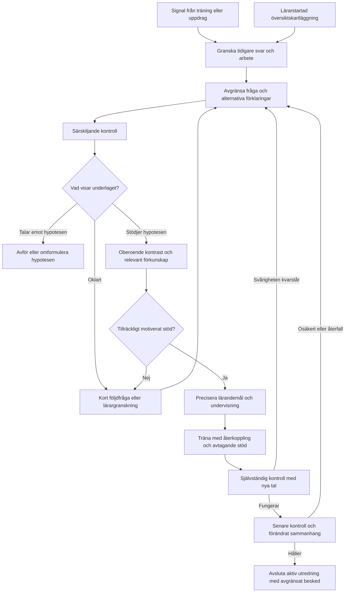

# Utredningsmall: från felsvar till hållbar förståelse

Datum: 2026-10-30. **Första genomarbetade designfall, inte inkopplat i appen.**
Alla svar och förlopp nedan är konstruerade. De är inte elevobservationer.
Regler för antal frågor och senare uppföljning är förslag, inte validerade
gränser. Syftet är att precisera didaktiska beslut före implementation.

## Gemensam struktur, två ingångar

Fri träning/uppdrag ger en signal att undersöka. En lärarstartad bred
kartläggning söker också efter områden där tidigare underlag saknas.
Båda går in i samma utredning; ett helt diagnoshäfte är inget obligatoriskt
försteg. Befintligt relevant kunnande ska minska behovet av nya frågor.
Ett enstaka fel kan motivera en billig kontroll, inte en färdig diagnos.

Oklart underlag får inte skapa en obegränsad frågeloop. Följ pilotens budget
om högst fem nya diagnostiska frågor per pass; lämna kvar osäkerhet och en
konkret lärarfråga när budgeten är slut. Undervisning och senare uppföljning
är separata tillfällen, inte ett sätt att kringgå frågebudgeten.

## Första fall: subtraktion med en växling

**Utredningsfråga:** förstår eleven varför ett tiotal behöver bytas mot tio
ental och hur det förändrar båda positionerna i en skriftlig subtraktion?

Källankare är M02/N2 (AS2), med AG3 som relevant förkunskapskontroll enligt
[pilotens källkontroll](NCM_ADAPTIVE_SCREENING_PILOT.md). AS2 är en
diagnosreferens, inte en elevetikett eller en bekräftad felorsak. Kopplingen
AS2–AG3 är kontrollerad i lokala facit; undervisningssekvensen och de egna
uppgifterna nedan är vårt designförslag, inte ett påstående om NCM:s ordalydelse.

Hela [NCM-inventeringen](NCM_DIDACTIC_COVERAGE.md) ligger kvar som ryggrad.
Ett genomarbetat AS2-fall täcker inte decimaler, växling genom noll, andra
räknesätt eller katalogens övriga begrepp och luckor.

### 1. Upptäck och avgränsa

Konstruerad startsignal: **642 − 217 = 435**. Facit är 425. Svaret stämmer
med att ta större siffra minus mindre i varje kolumn, men visar inte att
eleven faktiskt gjorde så. Läs eventuell uträkning och relevanta historiska
rätta och felaktiga svar innan följdfrågan väljs.

| Möjlig förklaring | Vad behöver skiljas åt? |
|---|---|
| H1: större minus mindre i varje kolumn | Ger felregeln rätt prognos även på en annan särskiljande uppgift? Stämmer arbetet med den? |
| H2: växlingen genomförs men tiotalet minskas inte | Båda reglerna kan ge samma slutsvar. Kräver granskning av växlingssteget eller förklaring, inte bara ytterligare facitkontroll. |
| H3: osäker tiotalsövergång i mindre tal | Pröva relevant AG3-liknande förkunskap utan att tvinga fram en uppställning. |
| H4: tillfällig beräkning eller fel överföring till svarsfält | Jämför sparad uträkning med slutsvaret och välj en ny jämförbar uppgift. |

Tomt svar, gammalt fel följt av relevanta fungerande exempel eller enbart en
automatisk felkod ger inte stöd för att fastställa H1. Arbete utan slutsvar
bevaras som arbete, inte som ett konstaterat matematiskt fel.

### 2. Undersök med minsta nödvändiga frågor

| Egen kontrolluppgift | Facit | H1 ger | Funktion |
|---|---:|---:|---|
| 764 − 231 | 533 | 533 | Valfri baslinje om jämförbart underlag saknas. Kan inte utesluta H1. |
| 642 − 217 | 425 | 435 | Startobservation eller ny kärnkontrast; återanvänd inte som oberoende bekräftelse. |
| 753 − 428 | 325 | 335 | Parallell kontrast med en växling. Bevara elevens arbete. |
| 13 − 8 | 5 | Ej tillämpligt | Förkunskapsfråga om underlaget gör den relevant. |
| 14 − 6 | 8 | Ej tillämpligt | Alternativ kontroll vid osäker förkunskap och kvarvarande budget. |

H1 och H2 kan ge samma felsvar på kärnkontrasterna. Fråga därför exempelvis:
**”Vad händer med tiotalen när du växlar ett tiotal till ental?”** Låt eleven
förklara sin egen lösning. Ge inte instruktionen hur växlingen ska göras
och räkna sedan det hjälpta svaret som självständigt diagnostiskt belägg.
En förklaring som inte kan tolkas automatiskt lämnas till läraren.

Föreslagna beslut:

- Rätta särskiljande svar med förenlig, granskad metod talar emot den
  aktuella misstanken. Fel på en annan svårighet får inte flyttas hit.
- Upprepade modellförenliga fel plus förenlig granskad metod ger stöd för
  en avgränsad metodhypotes, inte en säker allmän kognitiv orsak.
- Fungerande mindre-tal-kontroller men svårighet med skriftlig växling
  motiverar undervisning om representation och växling.
- Osäker mindre-tal-kontroll motiverar att också undersöka förkunskapen.
  Säg inte att den bevisligen orsakade det ursprungliga felet.
- Rätt slutsvar med motsägande metod eller olika regler som ger samma svar
  lämnas öppet. Fler likadana tal löser inte den oklarheten.

### 3. Välj undervisning utifrån vad som faktiskt framkom

**Lärandemål:** eleven ska kunna omgruppera ett tal utan att ändra dess värde,
använda det i subtraktionen och förklara varför tiotal och ental ändras ihop.

För växlingsspåret föreslås denna korta sekvens:

1. Använd ett mindre exempel: 32 − 17. Låt eleven jämföra
   **32 = 30 + 2 = 20 + 12**. Värdet är detsamma; uppdelningen förändras.
2. Beräkna **(20 + 12) − (10 + 7) = 10 + 5 = 15** och knyt delarna till
   elevens skriftliga uppställning. Fråga varför svaret 25 inte kan följa
   av att samma 32 har behållits hela vägen.
3. Eleven arbetar med 43 − 18 = 25 och förklarar vad som ändras i båda
   positionerna. Ge återkoppling på det observerade steget.
4. Flytta till tresiffriga tal när omgrupperingen fungerar. Minska stödet
   från gemensam lösning till elevens förklaring och självständigt arbete.

Vid osäker förkunskap föregås detta av riktat arbete med tiotalsövergång
och uppdelning av mindre tal. Vid enbart felöverföring behövs i stället
uppföljning av svarsinmatningen; hela växlingsundervisningen är inte given.
Träningsmängden bestäms av vad eleven visar, inte ett fast antal felsvar.

### 4. Skilj träningsframgång från självständig kontroll

Alla hjälpta lösningar märks som sådana. Träningsfeedback kan visa framsteg
men stänger inte utredningen. En separat kontroll använder nya uppgifter,
utan visat exempel, ledtråd eller korrigering före det första sparade svaret.

| Kontroll | Facit | H1 ger | Vad den prövar |
|---|---:|---:|---|
| 831 − 416 | 415 | 425 | Ny självständig uppgift med samma kritiska växling. |
| 972 − 548 | 424 | 436 | Annan sifferkombination med samma mekanism. |

Föreslagen pilotregel: två olika särskiljande kontroller med förenlig granskad
metod ger status **”fungerar självständigt nu; senare uppföljning återstår”**.
Detta är ett granskningsbart designval, inte statistiskt bevis eller en
generell två-frågorsregel för hela appen. En uppgift som eleven redan fått
hjälp med räknas inte som en ny oberoende kontroll.

### 5. Kontrollera senare och i ett förändrat sammanhang

Planera nästa kontroll till ett senare undervisningstillfälle, skilt från
den just genomförda träningen. Exakt intervall är ännu inte beslutat eller
kalibrerat och får inte döljas bakom en påhittad standardgräns.

- **752 − 436 = 316**, medan H1 ger 324: ny kontroll av samma delmoment.
- **”Du har 83 kr och betalar 46 kr. Hur mycket har du kvar?” = 37 kr**:
  förändrat sammanhang; H1 skulle ge 43 om samma kolumnregel används.

Textuppgiften tillför språk och räknesättsval. Ett fel där, samtidigt som
den rena beräkningen fungerar, ska därför undersökas separat och inte
automatiskt återöppna samma växlingshypotes. Eleven får använda en egen
giltig metod; uppställning krävs bara när just den metoden ska undersökas.

Avslutande lärarbesked ska beskriva omfattningen, exempelvis:
**”Eleven har nu visat självständig subtraktion med en växling på nya tal,
även vid senare uppföljning. Den tidigare felregeln framträder inte i dessa
kontroller. Växling genom noll och decimaler har inte prövats.”**

Undvik ”felförståelsen är permanent borta”. Ett återkommande fel öppnar en
ny uppföljning med bevarad historik, inte en omskrivning av tidigare belägg.

## Det appen behöver hålla reda på

Varje aktiv utredning behöver mål/delmoment, ingång, källreferenser och
revisioner, observationer för och emot varje hypotes, alternativa förklaringar,
valda frågor och deras syfte, granskarbedömning, stöd som eleven fått,
undervisningsmål samt beslut, version och nästa uppföljning.

Tänkbara tillstånd är **signal → undersöks → hypotes stödd → undervisning →
självständig kontroll → senare uppföljning → avslutad för prövat delmoment**.
”Otillräckligt underlag” och ”behöver lärargranskning” måste kunna bevaras
utan påtvingad diagnos. En avförd hypotes och ett avbrutet pass är egna utfall.

Detta är en begreppsmodell, inte en beslutad databas- eller API-migration.
Återanvänd befintlig evidens, rapporthistorik, granskning och materialutkast;
skapa inte en konkurrerande profil eller separat kopia av elevens original.
Fri träning samlar underlag utan att i smyg byta elevens aktivitet. Läraren
startar utredningen och godkänner utdelning enligt befintligt flöde.
Diagnostiska kontroller ändrar inte automatiskt vanlig mastery/progression.

## Klart-när och nästa byggsteg

### Beslut: regelmotor först, AI vid tolkningsbehov

2026-10-30: Simon beslutar att kända matematiska felmodeller och didaktiska
beslutsregler ska vara körbar programkod. AI ska inte behöva återupptäcka en
känd felmetod för varje elevsvar. Flödesschemats rutor anger didaktiska
handlingar, inte ett AI-anrop per ruta. Detta är en beslutad ansvarsfördelning;
det innebär inte att alla regler redan är implementerade eller publicerade.

| Ansvar | Körs som vanlig kod | AI/lärare används när det behövs |
|---|---|---|
| Observera | Facit, numerisk avvikelse, sparstatus och tillgängliga strukturerade steg | Tolka fri text eller arbete som saknar en säker strukturerad läsning |
| Matcha felmodeller | Beräkna vad varje tillämplig känd felmodell ger och jämför med svaret | Föreslå förklaring för okända eller motsägande fall, tydligt märkt som tolkning |
| Välja nästa fråga | Versionsbundna regler väljer bland granskade kontraster/förkunskapsfrågor | Föreslå nytt innehåll när befintligt underlag inte räcker, för granskning |
| Välja undervisning/träning | Matcha avgränsat behov till granskade mål, mallar och träningssekvenser | Anpassa eller formulera material när färdiga upplägg inte räcker |
| Följa upp | Nya ohjälpta kontroller, tidigare exponering, tillfällen, budget och stopp | Granska kvarstående osäkerhet och didaktiska undantag |
| Redovisa | Spårbara standardmotiveringar, originalreferenser och begränsningar | En sammanhängande lärarsammanfattning vid behov |

Vanliga svar och kända modellträffar ska kunna passera denna kedja utan
AI-token. Ingen AI behövs för att räkna avvikelsen +100 eller återge en
granskad standardmotivering. Inte heller träning måste nygenereras med AI
när en lämplig granskad mall finns. AI är ett komplement; den ska inte
krävas för att en redan känd regel ska fungera. Kostnad eller svarshastighet
får inte motivera att osäkerhet ersätts med en säker felorsak.

Tre skilda utsagor ska bevaras även när allt görs automatiskt:

1. **Observation:** exempelvis 402 − 178 = 324, alltså +100 från facit.
2. **Modellträff:** det specifika svaret kan produceras om hundratalet
   behålls när ett hundratal växlas till tiotal. Det är en beräknad kandidat.
3. **Belagd metod:** originalarbete eller särskiljande kontroller stödjer
   att eleven använder metoden. Svaret ensamt bevisar inte detta.

En generell ”+100 betyder glömt hundratal” är därför ingen godkänd regel.
Kontrollera att uppgiften har den aktuella växlingskedjan och beräkna den
felmodellens resultat. Om flera modeller ger samma svar ska alla relevanta
kandidater behållas och en särskiljande fråga eller metodgranskning väljas.
En träff får inte bli säker felorsak bara för att den låg först i kodens lista.
Tillgängliga strukturerade rutor/markeringar kan användas av specifika
kontroller; allmän automatisk handskrifts- eller resonemangstolkning antas inte.

### Genomförandeordning efter detta beslut

1. **Samla och granska befintliga regler mot hela NCM-inventeringen.**
   Återanvänd analysmotorerna. Varje regel behöver begrepp/källankare,
   tillämpningsområde, förväntat felsvar, alternativa förklaringar och vad
   som krävs för ett starkare besked. Skilj NCM-kod från lokal felmodell.
   Håll övriga områden synliga som befintligt stöd, behöver rättas eller
   återstår; bygg inte en konkurrerande katalog vid sidan av ryggraden.
2. **Fyll första konkreta luckan: växling genom noll.** Befintliga regler
   täcker större-minus-mindre per kolumn respektive noll där växling krävs.
   Lägg till och kontrollera kandidatmodeller för oförändrat givande
   hundratal och för tio i stället för nio tiotal efter vidare växling.
   Börja avgränsat med heltal och en inre nolla; utvidga bara med egna belägg.
3. **Koppla modellträffar till den befintliga frågeväljaren.** Bär med ref,
   revision, regelversion, tillämplighet och kvarstående alternativ.
   Appen väljer granskad följdfråga och standardmotivering utan nytt AI-anrop.
   Saknad metadata eller okänd metod behålls som osäkerhet. Tränings- och
   screeningposter får inte ges påhittade gemensamma signaler.
4. **För in en lärargranskad ingång i befintligt analys-/materialflöde.**
   Visa vad reglerna observerat, vad som fortfarande är en hypotes och
   föreslaget nästa steg. Precisera lagring och åtkomst för granskning,
   undervisning och kontroller. Bevara lärarens avsiktliga start/utdelning
   och diagnostikens separation från vanlig mastery.

Klart-när för första regeldelen: granskade syntetiska tal skiljer de avsedda
modellerna åt där det är möjligt, överlapp visas som överlapp, +100 utanför
modellens område ger inte samma etikett, rätt svar ger ingen felsignal och
ingen AI-anropare behövs för modellmatchning eller nästa granskade fråga.
Kontrollera även saknade växlingsmetadata, arbete utan slutsvar och att
befintliga felmodeller inte försämras. Talexemplen ska omfatta minst
402 − 178 = 324 respektive 234, plus parallella och negativa fall.

En första körbar tillämpning av kontraktet för subtraktion och bråkjämförelse
finns nu i [den fristående utredningsprototypen](NCM_INVESTIGATION_PROTOTYPE.md).
Den prövar även undervisning och uppföljning; det är fortfarande ingen elevväg.

Den första mallen är beskriven när varje övergång har observation, alternativ
förklaring, nästa handling och begripligt stoppbesked; särskiljande tal har
kontrollerat facit och träningsstöd hålls isär från självständiga kontroller.
Detta dokument uppfyller beskrivningssteget, inte didaktisk elevvalidering.

Den revisionsbundna evidensadaptern och provningen av ett andra område
(bråkjämförelse) är genomförda offline. Nästa steg följer ansvarsfördelningen
och ordningen ovan; adaptern är inte därmed inkopplad i appen.

Inget i denna leverans sparar elevdata, reviderar tidigare elevutkast,
tilldelar träning eller publicerar appfunktioner.
