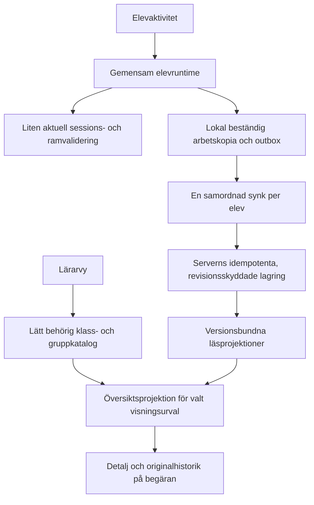

# Kort arkitekturplan för väntetider — 2026-10-29

Status: förslag före kodändringar. Beställt: kartläggning och plan.
Underlag: [prestandakartläggningen](PERFORMANCE_MAP.md). Inga funktions-
ändringar, datamigreringar eller publiceringar är beställda genom denna plan.

## Riktning

**Vyernas första användbara tillstånd ska bero på minsta giltiga data.**
Läraren ska kunna välja klass/grupp utan att hämta elevhistorik. Eleven ska
kunna byta aktivitet utan att dränera hela synkkön och återhämta sin fulla
historik. Sessions- och uppdragskontroller ska fortfarande ge rätt elev,
aktuell behörighet och exakt vald aktivitet.

## Data och ansvar

| Del | Ägare och innehåll | Aktualitet och gräns |
|---|---|---|
| Identitet och behörighet | Befintlig serverauth, session/credentialVersion och tombstones | Servern kontrollerar fortsatt varje API-åtkomst; utgången/bytt identitet spärrar vidare start |
| Katalog | Behöriga klass-/grupp-ID:n och visningsmetadata | Visas oberoende av statistik; cache isoleras per konto och scope; borttagen behörighet får inte återuppstå ur cache |
| Elevens arbetsläge | Gemensam runtime, samma elevs krypterade snapshot och outbox | Lokalt event + snapshot hålls atomära; minsta färska validering före start; ny serverrevision/ram ger explicit återläsning eller rebase |
| Läraröversikt | Liten separat läsprojektion, inte komplett profil | `sourceRevision`, regelversion, tidsfönster, täckning och beräkningstid; föråldrad statistik märks och repareras |
| Original och historik | Befintliga domänlager och källreferenser | Hämtas med elev/klass/period och sidgräns; ingen historik trimmas eller räknas om pedagogiskt för att göra UI snabbt |

Lätta projektioner behöver kunna läsas som små poster i lagringen. Att läsa
hela `student:*` och sedan kasta bort fält är inte den avsedda slutarkitekturen.
Återanvänd och verifiera befintliga medlemsindex före eventuell backfill;
sekundärt medlemskap och äldre konton får inte tyst falla bort.
Versionsätt de nya läskontrakten. Befintligt list-schema, export och MCP
ska kunna fungera under övergången; minska inte deras datainnehåll tyst när
dashboarden flyttas till en lättare projektion.

Sammanfattningar ska använda samma domänregler som idag. De kan byggas som
revisionsbundna, återbyggbara projektioner med begränsat omräkningsarbete,
inte som en ny konkurrerande sanning. Svenskt dygn/vecka och regeländringar
ska ogiltigförklara gamla periodvärden även utan ett nytt elevsvar.
En eventuell asynkron reparationskö måste vara beständig och kvitterad;
serverless fire-and-forget är inte en leveransgaranti.

## Genomförande i ordning

| Etapp | Förändring när implementation beställs | Klart när |
|---|---|---|
| M0 — mätkedja | Komplettera API-stickprovet med browser- och servermått i avgränsad testmiljö | Login och två elevbyten har samma korrelationskedja; auth, KV, kö, CPU och rendering kan skiljas; inga elevvärden loggas |
| P1 — oberoende katalog | Hämta/publicera klass- och gruppmetadata separat. Återanvänd den skrivskyddade klassprojektionen via UI-adapter. Stabilisera laddningslivscykeln och slå samman samtidiga likadana läsanrop. Flytta GET-initiering till explicit setup/migrering. | Katalogen visas även om elevhistoriken är långsam eller misslyckas; etikettstatus/fokus startar inte en extra hel uppstart; befintliga val ligger kvar |
| P2 — lätt översikt | Flytta nödvändiga signaler till separata små läsposter, scope-/sidavgränsa hämtningen och begär detaljdata först vid användning. Adapter för befintliga paneler under övergången. | Översikten läser inte full historik eller fulla `recentProblems`; siffror och täckning stämmer mot originalen; saknade/föråldrade projektioner är synliga |
| P3 — elevens kontinuitet | Låt samma runtime äga session, arbetskopia och en synkarbetare över routebyten. Föreslå ett litet bootstrap-svar med giltig identitet, ram-/profilrevision och nödvändig aktuell startdata i stället för resume + full profil + separat config. | Varmt aktivitetsbyte väntar inte på ködränering; serverns auth och ändrade uppdrag respekteras; varje svar finns kvar efter omstart och kvitteras en gång |
| P4 — återstående kostnader | Följ mätningen för resterande beräkningar, privat cache och eventuell uppdelning av start-JS | Förbättringen kan hänföras till ett mätt steg och gäller också iPad; inga breda ombyggnader för antagen vinst |

M0 ska föregå ändrat funktionsbeteende. P1 är en första leverans av denna
arkitektur; P2 behövs för att få bort 35 MB-kontraktet. P3 löser samma
beroendeproblem för eleven. Varje etapp granskas separat, kan återställas
utan dataförlust och publiceras först med separat mandat.

Behåll nya räkningsomgångar, uppdragsräknare och start/slut per aktivitet.
Avgränsa lokal köläsning med status/index i stället för `getAll()` över
växande historik; kvittenser och avvisade original ska fortfarande bevaras.
Det är identitets-/transport-/arbetskopieuppstarten som ska återanvändas,
inte föregående aktivitets räknare. Bakgrundsuppdatering får inte byta en
pågående uppgift, svarstext, rityta eller tilldelning bakom elevens rygg.

## Föreslagna budgetar för verifieringen

Målen nedan är förslag, inte uppmätta resultat eller redan antagna produktkrav.
Mät på angiven enhet/nätprofil, med minst 30 körningar per fall och redovisad
spridning. Tre API-prov från kartläggningen räcker inte för p95.

| Mått | Föreslaget mål |
|---|---|
| Klasser/grupper användbara efter lyckat loginsvar | p95 ≤ 2 s; utan beroende till profil-/historik-GET |
| Första klassöversikt, referensklass 30 elever | p95 ≤ 3 s; ≤ 250 KiB uppackad översikts-JSON, inga fulla svarshistoriker |
| Varmt byte av aktivitet med giltig identitet/ram | p95 ≤ 1 s till användbar aktivitet; full profil endast vid verifierat behov |
| Lokal beständig svarskvittens | p95 ≤ 250 ms på mål-iPad; server-ACK mäts separat och visas korrekt |

Kall inloggning, återkallad session, ändrad ram och stor kö är separata fall;
de får inte döljas i den varma mätserien. Klart-villkoret innefattar oförändrad
behörighet, exakta mottagare och sparade svar, inte bara kortare laddningsindikator.

## Verifiering och avgränsning

- Jämför kort/lång historik, tom/stor kö, två flikar och återkomst från
  bakgrund. Klassbelastning provas syntetiskt, inte mot pågående lektion.
- Testa förlorad kvittens, omstart under synk, offline/återanslutning,
  konto-/klassbyte, utgången/återkallad session och elevradering. Behåll
  event-ID:n, CAS, kryptering, rejected-original och kvitteringsregler.
- Jämför översiktens värden med samma källrevision: mastery,
  diagnostik/practice_only, täckning, datumskifte och gruppmedlemskap.
- Behåll vyurval, privata etiketter, osparade utkast och Framstegs befintliga
  utseende. Ingen generell omdesign, domänregeländring eller cache av privata
  svar i publik CDN ingår.
- Återanvänd React, Node och Redis/KV. Byte av databas eller ramverk är
  inte motiverat av den nuvarande mätningen. MCP-API:er och skills byggs inte
  vidare inom detta spår.

Nästa konkreta uppgift är M0:s tidslinje för elevbyte och därefter P1 enligt
klara mätgränser. Ingen implementation eller publicering har startats.
