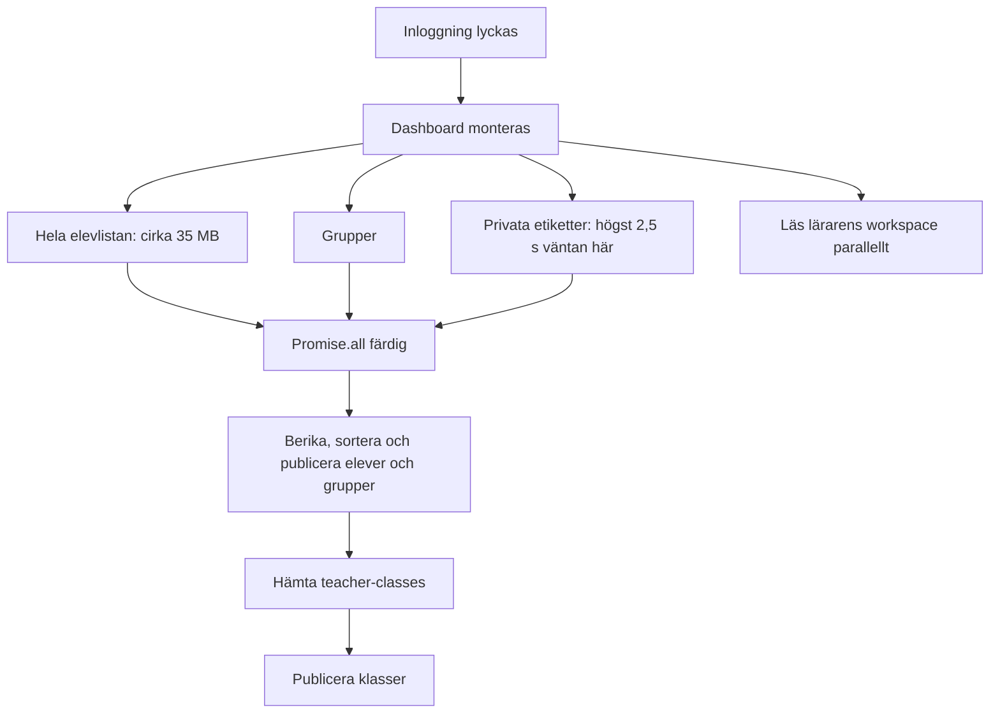

# Prestandakartläggning — 2026-10-29

## Slutsats och omfattning

Väntan har en gemensam arkitektonisk form: vyer väntar på mer data och fler
serversteg än deras första användbara tillstånd behöver. Det är belagt i
koden för både lärarstart och elevens aktivitetsbyte. Lärarens stora läsanrop
är också mätt i produktion. Elevbytets exakta tidsfördelning är ännu inte mätt.

Det tydligaste nya fyndet är `/api/students`: **34 972 006 byte uppackad JSON**
för 160 profiler, trots att det är listkontraktet utan `problemLog`.
`recentProblems` står för 81,3 procent och `adaptive` för 11,6 procent.
Enbart fler parallella anrop eller kortare JSON efter databasläsningen
löser därför inte hela problemet.

Uppdraget omfattar kartläggning och plan före funktionsändring. Ingen app-,
API-, databas-, konfigurations- eller skillkod har ändrats. MCP-arbetet är
pausat. Nästa föreslagna arbete finns i [arkitekturplanen](PERFORMANCE_ARCHITECTURE_PLAN.md).

## 1. Baslinje och belägg

| Underlag | Revision/status |
|---|---|
| Arbetskopian där dokumenten sparas | `feature/more-figures`, `dcac352` |
| GitHub master, kontrollerad denna kartläggning | `36f89df7b8c64f46542bb0da211b31a1df3778ce` |
| Produktion | Vercel `sekvens`, `dpl_Fw1MWk5EwLHgxUj9idGUSYiTYRhK`, READY, samma SHA, alias matematik.ximon.se |
| Källjämförelse | Centrala elev-, dashboard-, profil-, session-, klass-, grupp- och sammanfattningsfiler som används nedan är identiska mellan arbetskopian och denna master |

Befintliga ändringar i `.agents/skills/assignment-authoring/SKILL.md` och
`.agents/skills/teacher-data/` tillhör annat arbete och bevaras. Kartans
befintliga innehåll i denna arbetskopia sammanförs inte med andra checkoutar.

Beläggstyper i dokumentet:

- **Mätt:** specificerat anrop mot produktion, med metod och stickprovsstorlek.
- **Kodbelagt:** verifierad kontroll-/dataväg, utan påstående om dess exakta tidsandel.
- **Kvar att mäta:** rimlig kostnad eller möjlig förstärkare, ännu inte tidsatt.

## 2. Produktionsmätning: lärarens läsanrop

Tre sekventiella omgångar per listanrop på **adminperson**. Vanlig
teacher-login följdes av GET-anrop med dess token. Inga elev-/uppdrags-
skrivningar gjordes. Inloggningen skapar ett sessionsbevis; dess innehåll,
lösenord och cookies sparades inte. Inga privata etiketter hämtades.

| Anrop | Antal prov | Färdigt svar inkl. JSON, sekunder | Uppackade byte | Resultat |
|---|---:|---|---:|---|
| `POST /api/teacher-login` | 1 | 0,65 | 709 | HTTP 200 |
| `GET /api/students?resource=classes&limit=100` | 3 | 1,78 / 1,63 / 1,63 | 435 | HTTP 200, 9 klasser |
| `GET /api/teacher-groups` | 3 | 0,80 / 0,71 / 0,81 | 6 218 | HTTP 200, 2 grupper |
| `GET /api/students` | 3 | **12,54 / 10,81 / 11,13** | **34 972 006** | HTTP 200, 160 profiler |
| `GET /api/class-config` för befintlig Test-klass | 1 | 0,43 | 371 | HTTP 200 |
| Publikt start-HTML | 1 | 0,56 | 409 | HTTP 200 |

För `/api/students` var tiden till HTTP-headers 8,49–10,72 sekunder,
bodyhämtningen 1,58–2,09 sekunder och JSON-parsningen i Node 0,22–0,32
sekunder. Tiden före headers omfattar nätverk, server, databas och
serialisering; dessa delar kan inte separeras utan servermätning.

Svaret var Brotli-komprimerat. **35 MB är uppackad JSON, inte uppmätt
överföring på nätet.** `Content-Length` saknades för det komprimerade svaret.
Mätprogrammets extra summering av fältstorlekar är exkluderad från tabellens
svarstider och redovisas separat i JSON-underlaget.

| Fält i elevlistans profiler | Summerade byte | Andel av hela svaret |
|---|---:|---:|
| `recentProblems` | 28 448 603 | 81,3 % |
| `adaptive` | 4 047 960 | 11,6 % |
| `teacherSummary` | 847 034 | 2,4 % |
| `telemetry` | 820 840 | 2,3 % |

Fältens värden har inte analyserats; inga individuella namn, ID:n, frågor
eller svar finns i mätfilerna. Uppgifterna visar kontraktets storlek, inte
vilken elev eller frågetyp som orsakar den. Antalsgränsen 250 för
`recentProblems` är uppenbarligen ingen tillräcklig bytegräns.

En separat publik hämtning gav start-JS 1 699 002 uppackade byte på 0,48
sekunder och CSS 137 746 byte på 0,07 sekunder, båda CDN HIT. JavaScriptets
exekvering, React-rendering och fysisk iPad mättes inte. Dessa enstaka
resurstider utesluter inte ett problem vid kall start på en långsam enhet.

Sanitiserade råmätningar:
[API-anrop](evaluations/performance-2026-10-29/api-read-baseline.json) och
[publika startfiler](evaluations/performance-2026-10-29/public-assets.json).
Tre prov är ett stickprov med median/intervall, **inte ett p95-belägg**.

## 3. Lärarens kritiska väg

Kod: [Dashboard.jsx](../src/components/teacher/Dashboard.jsx), `loadStudents`
och monteringseffekten; [storageCloudSync.js](../src/lib/storageCloudSync.js),
`getAllProfilesWithSync`; [dashboardClassAndAuthActions.js](../src/components/teacher/sections/dashboardClassAndAuthActions.js).

- **Kodbelagt:** grupperna hålls tillbaka tills elevhämtningen är klar.
  Klassanropet startar först därefter. Lokal klasscache kan visa tidigare
  uppgifter tidigare, men en tom cache saknar den möjligheten.
- **Kodbelagt:** `getAllProfilesWithSync` väntar på nätverk och normalisering;
  den återger inte en omedelbar lokal elevlista i detta läge.
- **Kodbelagt förstärkare:** när `labelsLoaded` ändras får `loadStudents` en
  ny identitet. Monteringseffekten beror på callbacken och kan då starta
  elev-/grupp-/workspacehämtningen igen. Sekvensnumret hindrar gammalt svar
  från att skriva över nytt, men avbryter inte det gamla nätverksarbetet.
- **Kodbelagt:** automatisk uppdatering sker även vid tillåtet fönsterfokus
  och varannan minut. Det är inte ett anrop per elevs aktivitetsbyte.
- **Kvar att mäta:** faktisk överlappning och antal anrop i en normal
  browserstart, privata etiketter, `teacher-classes`, frontendnormalisering,
  sortering och den slutliga renderingen.

Förenklad väntetid med tom cache:
`max(elevlista, grupper, begränsad etikettväntan) + frontendarbete + klassanrop`.
Det uppmätta elevanropet passar med en betydande del av Simons rapporterade
20 sekunder. Det är inte en uppmätt full fördelning av hans inloggning.

### Server och läskontrakt

[api/students.js](../api/students.js) läser `students:index`, sedan kompletta
`student:*`-poster i sekventiella omgångar om 20. Därefter hämtas behöriga
klasser och klassposter, elever filtreras och `withFreshTeacherSummary`
körs för varje kvarvarande profil. Först därefter begränsas svarsfälten.

Det finns alltså två kostnader: den stora lagrade profilen läses innan
projektion, och det projicerade listsvaret är fortfarande nästan 35 MB.
Serverns sammanfattning traverserar historik, perioder, mastery och
tabellunderlag. Frontend bygger därefter rader för alla elever före
visningsfiltrering i [useDashboardViewData.jsx](../src/components/teacher/sections/useDashboardViewData.jsx).
CPU-andelarna är ännu inte mätta separat.

Grupp-GET läser även lärarkandidater från kontoregistret. Klassbehörighet
gör flera konto-/klassläsningar. Det är merarbete att granska, men de nya
mätningarna pekar först på elevlistan, inte grupperna, som största väntan.

**Läsning med sidoeffekt:** äldre `GET /api/teacher-classes` kan skapa
saknade loginToken-värden; standardnamn kan fyllas via en automatisk POST
från Dashboard. Dessa anrop provades inte i denna läsmätning. Det separata
`resource=classes` är en skrivskyddad ID-/namnprojektion och kräver en adapter
om det används i UI, vars nuvarande klassobjekt har fler fält och andra ID-fältnamn.

## 4. Elevens kritiska väg

Kod: [pilotStudentRuntime.js](../src/lib/pilotStudentRuntime.js), `bootstrap`;
[usePracticeSetupEffects.js](../src/components/student/session/usePracticeSetupEffects.js);
[StudentHome.jsx](../src/components/student/StudentHome.jsx).

- **Kodbelagt:** samma runtime-objekt och vault kan återanvändas, men
  `bootstrap` gör ändå en ny resume, väntar på outbox och hämtar serverprofil.
  `readSnapshot()` används inte för att direkt återge profilen i denna kedja.
- **Kodbelagt:** Home, Practice, Subitizing, Ticket och Diagnostic anropar
  bootstrap. Träningens legacygren har en annan synkväg och ska inte blandas
  ihop med QR/PIN-runtime i en mätning.
- **Kodbelagt:** `/api/student-session` och `/api/me/profile` gör varsin
  `getLiveStudentSession`: session, elevtombstones, full profil, klassernas
  tombstones och klassposter. Profil-GET räknar dessutom lärarsammanfattning.
- **Kodbelagt:** `class-config` startar när profilen ger klass-ID. Home
  hämtar sedan även uppdrag och diagnostiska uppdrag. Dessa listor är egna
  grenar och inte automatiskt spärr för varje första uppgift.
- **Kodbelagt:** aktivitetens start/slut skapar checkpoints och startar
  synkning. Effekten beror även på profilobjektet. Fler profilbyten kan
  därför ge fler livscykelhändelser; faktisk frekvens måste spåras.
- **Kvar att mäta:** två verkliga aktivitetsbyten, resume/profil/eventtider,
  lokal dekryptering, klasskonfiguration, render/uppgiftsval och väntan med
  tom respektive fylld outbox. Ingen elevcookiesession har hämtats eller
  några elevhändelser skapats för denna kartläggning.

När en aktivitet redan har profil och ram sker mycket av uppgiftsgenerering
och återkoppling lokalt. Det är förenligt med upplevelsen av snabba övningar
och långsamma övergångar; det ersätter inte en browserprofil av övergången.

## 5. Sparande och datakoppling

[pilotStudentStore.js](../src/lib/pilotStudentStore.js) krypterar snapshot och
event och sparar dem i samma IndexedDB-transaktion. Först därefter startar
`persistEvent` serverns synkning. Kvitterade event-ID:n skiljs från väntande
och avvisade original. Dessa egenskaper ska behållas.

`syncPending` läser och dekrypterar väntande poster, bygger begränsade batchar
och väntar på varje serversvar före ACK. Funktionen har ingen gemensam
in-flight-spärr för alla anropare; överlappande anrop kan därför göra samma
köarbete samtidigt. Faktisk förekomst och eventuell CAS-konkurrens är
obevisade här. Diagnostiska arbetskopior har dessutom egna skrivsvansar.

Lokal köläsning är inte heller avgränsad till väntande nycklar:
`listPendingEvents` och `countRejectedEvents` använder IndexedDB `getAll()`
innan filtrering. ACK markerar poster i stället för att ta bort dem.
Köstatus kan därför läsa även gamla krypterade kvittenser och andra
vaultposter. Det är en kodbelagd möjlig tillväxtkostnad, inte en uppmätt
orsak till sekunderna på Simons iPads. Indexerad statusläsning kan prövas
utan att radera historik eller ändra kvittens-/retentionsregler.

På servern läser sessionen profilen före eventhanteringen. Eventhanteringen
läser och skriver sedan profilen via revisionsskyddad CAS, med högst åtta
försök. Den kan också arkivera uppmärksamhetsdata. Lokal snapshot-kopiering,
stora profildokument, dubbelt köarbete och CAS-konflikter är separata
mätpunkter; inga event-POST gjordes i produktion i denna kartläggning.

## 6. Samlad bedömning

| Prioritet | Fynd | Belägg | Följd för strategi |
|---|---|---|---|
| 1 | Nästan 35 MB elevlista, 10,8–12,5 s färdigt svar | Mätt, tre prov | Fysiskt lätt översiktsdata; inte bara färre JSON-fält efter full läsning |
| 1 | Klasser och grupper hålls bakom elevlistan | Kodbelagt | Oberoende publicering av metadata och separata laddningslägen |
| 2 | Aktivitetsstart väntar på resume, outbox och full profil | Kodbelagt, inte tidsatt | Gemensam runtime och liten aktuell startvalidering; ködränering utanför navigering |
| 2 | Full profil används både för arbete, historik och läskontroller | Kodbelagt | Skilj identitet/ram, arbetsläge, läsprojektion och originalhistorik |
| 3 | Möjliga dubbla dashboardanrop, köanrop och livscykelskrivningar | Kodbelagt möjlighet | Single-flight, tydlig livscykel och spårning före åtgärd |
| 4 | Gemensamt start-JS cirka 1,7 MB; eager import av elev och dashboard | Kodbelagt + en resursmätning | Mät enhets-CPU; eventuell uppdelning efter de större datavägarna |

Varken Vercel-region, kallstarter, Redis-nätverkslatens, React-rendering
eller samtidighetsblockering mellan lärare och elever har isolerats som
huvudorsak. `Server-Timing` saknades i proven. Tidigare MCP-tider mäter
andra anropskedjor och ska inte användas som elevbytets baslinje.

Den äldre [synkplanen från mars](superpowers/plans/2026-03-23-sync-arkitektur-plan.md)
beskrev redan profilblobben och föreslog beräkning på bulk-GET. Aktuell kod
har krypterad lokal outbox och revisionsskydd som måste återanvändas;
marsplanen ska därför inte genomföras oförändrad. Planen nedan bygger på
den aktuella koden och de nya mätningarna.

## 7. Mätluckor att stänga före funktionsändring

1. Browser-tidslinje: login-knapp → klasser/grupper användbara, två
   aktivitetsbyten, samt server- och lokalköväntan var för sig.
2. Serverdelning: auth, index, KV-läsningar/byte, sammanfattnings-CPU,
   serialisering, CAS-försök och svarsstorlek. Logga bara mått och opaka
   korrelations-ID:n, inte elevinnehåll eller credentials.
3. Mät kontrollerat med kort/lång historik, tom/fylld kö och omstartad/
   återanvänd session. Jämför isolerade elevfall med syntetisk klassbelastning.
4. Kontrollera faktisk iPad/Safari, delad enhet, konto-/klassbyte,
   återkallad session och avvisade event. Ingen belastningsprovning mot
   riktiga lektioner eller elevskrivning för att skaffa en baslinje.

Kartläggningen och planen är klara som beslutsunderlag. Full end-to-end-
profilering av elevbytet och uppfyllda prestandabudgetar återstår.
